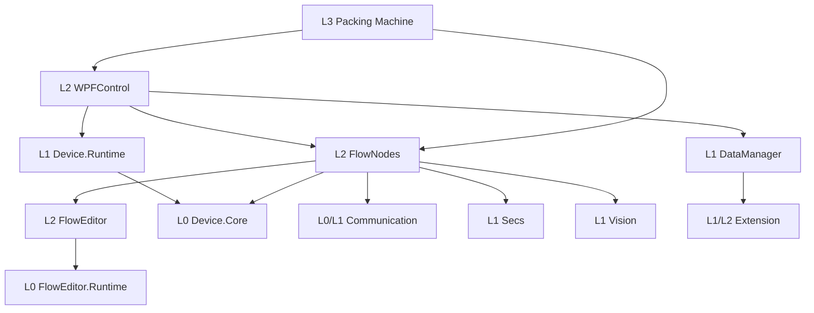

# 软件架构分级（2026-09-28）

## 评级口径

这里的“分级”同时表示**架构层级**和**当前结构成熟度**，两者不能混用。层级由项目职责和 `.csproj` 的显式依赖决定；成熟度来自边界清晰度、可替换性、测试入口和当前证据。它是本次静态检查的评估，不是运行可靠性评分。

| 架构层级 | 职责 | 典型项目 | 依赖方向 |
| --- | --- | --- | --- |
| L0 契约与纯逻辑 | 稳定模型、接口、算法，不依赖 WPF/厂商 SDK | `Device.Core`、`FlowEditor.Runtime`、`WPFCustomControls.PropertyGrid.Core`、`Communication` | 不向桌面 UI 和宿主反向引用 |
| L1 基础能力与适配 | 文件、数据、通信、设备运行时、视觉 SDK、SECS、控件基础能力 | `Extension`、`DataManager`、`Device.Runtime`、`Vision`、`Secs`、`MotionControl`、`NugetPackages` | 可依赖 L0；厂商细节留在适配处 |
| L2 功能模块与界面 | 可装配的编辑器、节点、业务界面、控件和脚本 | `FlowEditor`、`FlowNodes`、`WPFControl`、`WPFCustomControls`、`ScriptEditor`，以及各 `*.Controls` | 可依赖 L0/L1；同层共享 UI 依赖须明确 |
| L3 宿主与演示 | 组装模块、资源、配置及运行时入口 | `Packing Machine`、各 `*.Workbench` / `*Demo` | 向下引用；负责组合而非下沉业务规则 |
| L4 验证 | 自动化测试、基准与运行时冒烟 | 各 `*Tests`、`Communication.Benchmarks`、Runtime Smoke | 引用被验证层，不成为生产项目依赖 |

同一目录可包含多个层级，例如 Device 同时有 Core、Runtime、Controls 和 Workbench。`Extension` 是一个有 WPF 内容的单程序集，虽然内部有 Core 命名空间，**不能把整个程序集等同于纯 L0**。`Secs/secs4net-base` 的 `netstandard2.0;net9.0-windows` 多目标是既定兼容边界，不按统一 TFM 规则误判。

成熟度等级：**A**＝明确的纯逻辑边界和验证入口；**B**＝主要依赖方向清楚，但有局部平台或接口约束；**C**＝较大的装配/依赖半径或关键行为验证缺口；**D**＝尚无有效实现，无法形成可用模块。评级只针对当前仓库可见证据；没有运行时测量时不使用小数分。

## 模块评级

| 模块 | 主要层级 | 等级 | 静态依据与建议 |
| --- | --- | :---: | --- |
| Communication | L0/L1/L2/L3/L4 | B | 核心 `net9.0`，Controls/Workbench 为 Windows 层，有测试；继续守住协议核心与 UI 边界。 |
| DataManager | L1/L2/L3/L4 | B | 数据、控件、Workbench 和两组测试分开；基础库为 `net9.0-windows7.0`，若未来需要跨平台复用，再评估提取纯数据契约。 |
| Device | L0/L1/L2/L3/L4 | A | Core 为纯 `net9.0`，Runtime、Controls、Workbench 和测试分层；保留 Device 门面和现有调用方。 |
| Extension | L1/L2/L4 | B | 单程序集内部能力边界和架构测试已存在；接口能力不匹配见 [模块文档](Extension/OPTIMIZATION.md)。 |
| FlowEditor | L0/L2/L4 | A | Runtime 为纯 `net9.0`，WPF 编辑器单向引用，另有 Smoke、插件与宿主契约测试；继续按现有架构文档演进。 |
| FlowNodes | L2/L3 | C | 节点程序集直接引用 10 个项目，无本模块测试项目；见 [模块文档](FlowNodes/OPTIMIZATION.md)。 |
| MotionControl | L1/L4 | B | 硬件控制库有独立测试，未发现跨模块环；厂商能力仍须设备实测。 |
| NugetPackages | L1/L4 | B | 独立的 MX Interop 与测试；保持厂商边界，测试不在 `Frame.sln`。 |
| Packing Machine | L3 | C | 宿主直接引用 13 个项目且无宿主测试入口；见 [模块文档](<Packing Machine/OPTIMIZATION.md>)。高扇出对组合根本身是合理的。 |
| ScriptEditor | L2/L4 | B | 桌面脚本模块有独立测试，当前证据不足以提出结构拆分。 |
| Secs | L1/L2/L3/L4 | B | 本地 secs4net 副本、多目标和测试/样例有独立维护边界；保留既定兼容设计。 |
| Vision | L1/L2/L3 | C | 五项目分层但没有独立测试项目；InvI 行为错误与源码副本见 [模块文档](Vision/OPTIMIZATION.md)。 |
| WinFormControl | L2（预留） | D | 当前独立工程没有实际控件实现，也没有仓库内消费者；已清理空 `Class1.cs`，项目和解决方案保留以免误删潜在外部交付面。 |
| WPFControl | L2/L4 | C | 业务服务广泛通过容器定位依赖，虽有测试但单服务替换较困难；见 [模块文档](WPFControl/OPTIMIZATION.md)。 |
| WPFCustomControls | L0/L2/L4 | A | PropertyGrid Core 为纯 `net9.0`，WPF 适配与测试、架构文档分开；视觉问题仍需在实际宿主验证。 |

## 依赖规则与核对结果

本次从 63 个非临时 `.csproj` 提取跨模块 `ProjectReference`，合并为 15 个模块、44 条不同的有向边；拓扑检查遍历了全部 15 个模块，**没有发现跨模块项目引用环**。这是项目引用结论，不等于调用图没有递归：`codebase-memory` 报告的 32 个环是方法调用层面的强连通分量，不能作为模块循环依赖证据。

图只画主要路径。若后续拆分程序集，先明确公开类型、序列化标识、插件发现、配置文件和实际宿主装载路径，再调整引用。不得仅因一个项目引用多就拆项目，也不得把文件夹移动当作编译边界。

## 清理决策

本次实际删除及保留候选的核对记录见 [FILE_CLEANUP.md](FILE_CLEANUP.md)。目前没有证据支持删除 Vision 的第二份实现、secs4net 本地副本、历史架构文档或配置备份。`WinFormControl` 保留工程壳；若将来确认没有外部消费者，再决定是否撤销该工程和独立解决方案。

## 评估边界

项目引用和 TFM 由 `.csproj` 直接读取；符号关系先由 `codebase-memory` 查询，再读实际源码核对。索引对部分文件返回 `freshness: missing`，因此“无引用”判断另外用仓库范围文本搜索兜底。未访问目标硬件，也未用实际 WPF 宿主验证运行时装配；以上等级是结构评估，不是发布验收结果。
