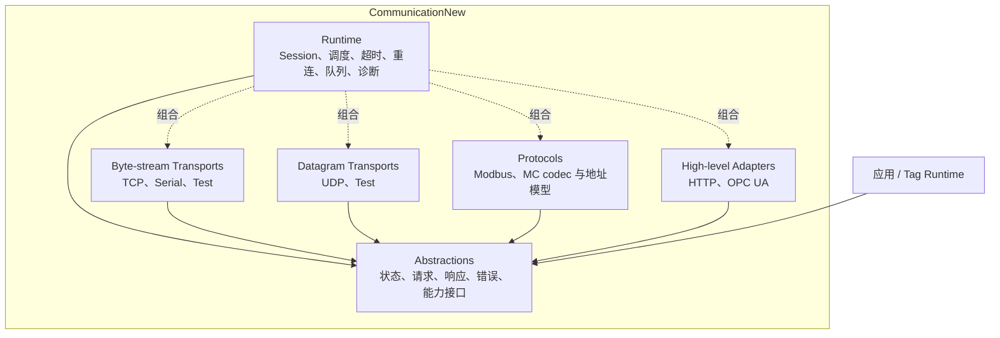

# CommunicationNew 架构优化方案

> 更新日期：2026-09-07
> 范围：`Communication/CommunicationNew`  
> 口径：本文是 CommunicationNew 架构优化的唯一入口，合并代码审计、外部项目调研、目标架构、迁移顺序和验收标准。

## 1. 结论

CommunicationNew 已覆盖 Socket、Serial、Modbus、MC、HTTP、WebApi 和 OPC UA，具备统一设备接口、数据点模型、轮询器、转换器和帧工具。项目可以编译，但当前设计仍属于功能原型。团队继续增加协议前，应先修复以下问题：

1. `Core/CommunicationFactory.cs` 依赖所有具体协议，协议实现又依赖 Core，形成 `Core → Protocols → Core` 的逻辑依赖环。
2. `ICommunicationDevice` 混合连接、地址读写、原始流收发、客户端和服务端能力。多个实现用空结果或 `NotSupportedException` 满足接口。
3. timeout token 没有传到真实 IO；后台接收、重连和断开任务缺少统一所有者，释放过程也没有等待任务退出。
4. `ByteUtils.BigEndian` 是进程级可变状态。两个设备配置不同端序时会互相影响。
5. 协议类直接创建 Socket、SerialPort、HttpClient 和具体 SDK 类型，缺少可替换的测试边界。项目还没有测试工程。

架构优化采用四个逻辑边界：`Abstractions / Transports / Protocols / Runtime`。首期保留一个程序集，用命名空间和架构测试约束依赖；边界稳定后再决定是否拆分项目。

### 1.1 实施状态（2026-09-07）

本文件同时记录目标和实际进度。当前 P0 至 P3 及三个横向架构项目均已完成；第 10 节后置项仍按真实业务需求决定是否启动，不计入本轮完成范围。

| 范围 | 状态 | 已落地内容 |
| --- | --- | --- |
| P0 稳定性地基 | 已完成 | 现有 251 个主库自动化测试；真实 IO 接收 timeout/cancellation；设备、轮询器和后台任务支持异步停止；`CommunicationDeviceBase` 为全部派生协议设备统一持有唯一释放任务，使断开、接收循环等待、后台操作排空和派生资源清理只执行一次；`DataPointAutoReader` 释放时共享唯一完成任务，释放开始后拒绝新的后台和手动轮询；Runtime `ReconnectSupervisor` 统一持有请求/响应 Session 与原始 TCP 的恢复循环，`ConnectionSession` 的并发释放调用共享同一个完成任务并只释放一次底层 transport，释放开始后不再接受排队或新发起的连接与请求；TCP、Serial、UDP transport 通过内部一次性释放 module 共享并发完成结果，避免重复关闭或释放底层资源，并在释放开始后拒绝排队或新发起的打开请求；`CommunicationManager` 拒绝重复设备 ID，并明确区分 factory 创建设备与外部注册设备的所有权转移；释放后不再接受设备注册、创建或移除，并发释放调用共享同一个完成任务；批量连接与断开优先使用新 `IConnection` seam，均支持调用方取消，旧接口的 `false` 连接结果会转换为带设备上下文的显式失败，单设备失败保持原异常，多设备失败保留全部异常，adapter 同步抛错也不会阻止其余设备获得生命周期命令，多个批量生命周期命令按提交顺序执行；设备移除、批量生命周期操作与整体释放通过同一生命周期门仲裁，移除和整体释放都会先等待此前已接纳的批量操作停止，再执行设备最终清理，且每个设备只调用一次 `DisposeAsync` seam；手工断开会取消并等待 supervisor，手工重连会替换失效 transport 代际；引入 generation 防止旧连接迟到结果破坏新状态；一天的重连间隔可由注入的虚拟计时器立即推进，测试不等待真实重连时间 |
| P1 Modbus TCP 竖切 | 已完成 | `TcpByteStreamTransport → Pipe → ModbusTcpCodec → ConnectionSession`；旧 `ModbusTcpClientDevice` 作为兼容 adapter；固定报文、任意两段切分、两帧粘包、loopback、挂起读取取消、真实远端关闭与旧 API 测试通过；请求队列有界，连接代际隔离迟到结果；写操作不做隐式重试 |
| 组合与宿主解耦 | 已完成 | 核心改为普通 `net9.0`；Prism 移至 `CommunicationNew.Prism`；设备 factory seam 已迁入 Core，Composition 旧接口已成为无成员的弃用兼容别名；新 `CreateDefaultFactory()` 直接返回 Core seam，旧 `CreateFactory()` 仅保留兼容转发；真实 Microsoft DI 宿主测试证明新旧接口解析到同一实例，Prism 在独立 integration 项目采用相同注册语义；`CommunicationManager` 主构造器要求显式注入 factory，无参构造与静态 `CommunicationFactory` 已标记为兼容入口；新增协议不再修改 Core 的 switch |
| 架构防回退 | 已完成 | 反射测试约束 Abstractions、Core、Transports、Runtime 的当前公开依赖方向，并扫描构造器、字段、属性、事件和方法；带弃用标记的兼容面由专门兼容测试管理；Abstractions 与 Protocols 的公共 API 均禁止暴露第三方 SDK 类型；旧 `ICommunicationDevice` 的成员集合已冻结；全部公开具体协议设备实现新 `IConnection` seam，设备基类实现新的 `IAddressReader` 读取能力 seam |
| 数据转换 | 已完成 | 删除进程级 `ByteUtils.BigEndian`；纯端序 codec 归属 Core，旧 Runtime 类型仅保留弃用兼容 adapter；按设备/点位注入不可变 `DataFormat`；ABCD/BADC/CDAB/DCBA 往返测试和每种格式 10,000 次的并发转换验证均通过 |
| P2 UDP 与 Serial | 已完成 | 新增 `IDatagramTransport`、`UdpDatagramTransport` 和 `SerialByteStreamTransport`；UDP/Serial 旧设备改为 `IConnection` 兼容 adapter；TCP、Serial、UDP 均验证重复打开、关闭幂等、释放不可逆及挂起读取或接收取消；loopback、数据报边界和旧事件测试通过 |
| P2 TCP 与 Modbus RTU 客户端 | 已完成 | 原始 TCP 客户端改用 `TcpByteStreamTransport` 且只有一个 Pipe reader，并把远端断线恢复交给 Runtime supervisor；新增类型化 RTU request/response、CRC codec，并将旧 RTU 客户端迁移到 `SerialByteStreamTransport → ModbusRtuCodec → ConnectionSession`；Modbus TCP/RTU 已把旧自动重连配置交给同一 supervisor；无调用者的旧 `SerialPortStreamResource` 已删除，主库不再依赖 NModbus；TCP/RTU 从站通过显式 `ModbusServerDataCodec` 共享大端寄存器与压缩位窗口转换，寄存器读取不再产生中间数组，奇数字节补零兼容行为由测试固定，非 8 对齐位地址会正确重打包并保护范围外相邻位 |
| P2 MC 客户端 | SLMP 已完成；MX 待实机验收 | 按官方 SLMP 字段顺序实现 3E/4E 二进制批量读写 codec、强类型地址和 4E 序列号校验；`McClientDevice` 已改为依赖 `IMcClientAdapter`，`SlmpMcClientAdapter` 使用 `TcpByteStreamTransport → McBinaryCodec → ConnectionSession` 并由 Runtime supervisor 重连；MX Component 支持主程序集直接调用和 net48 隔离桥接两种 adapter，但安装、授权和真实 PLC 读写尚未验收，因此不得标记为完整可用；既定范围外的 MC Serial 和扩展命令显式拒绝 |
| P2 高层 HTTP | 已完成 | HTTP/WebApi 客户端支持标准 `HttpMessageHandler` seam 和显式连接状态；GET 可按策略重试，POST/PUT/DELETE 不隐式重试；HTTP/WebApi 服务端通过内部 listener adapter 隔离 URL ACL，并在断开时停止、等待监听循环和在途请求 |
| P2 诊断 | 已完成 | `ConnectionSession` 已提供标准 `ActivitySource`、`Meter` 与可选 `ILogger`；操作时延与失败结果、连接、重连、活动连接、收发字节和请求排队指标均带低基数 protocol/transport 标签，并由 `MeterListener` 测试锁定；请求 trace 已细分 queue、encode、send、wait、decode 阶段；Runtime 有界 dispatcher 按协议和传输记录事件排队深度与丢弃量 |
| P2 其余协议迁移 | 已完成 | 原始 TCP 服务端已通过 listener adapter 接入显式状态；Modbus TCP/RTU 服务端均通过语义化 adapter 隔离 FluentModbus，并实现新 `IConnection` seam；共享 `FluentModbusServerDataAccessor` 在厂商 `ModbusServer.Lock` 内完成地址解析和数据区读写，避免异步请求处理与应用访问发生竞态；OPC UA 客户端使用真实 Session，服务端使用 `StandardServer + CustomNodeManager2` 暴露 ByteString 节点；安全配置已收敛为共享 profile，支持 Sign/SignAndEncrypt 与现代 SHA-256/AES 策略，明文和 Basic256Sha256 加密端到端 loopback 均通过 |
| P3 数据点与性能 | 已完成 | 已引入不可变 `ValueUpdate<T>` 和数据点原子采样；`DataPoint<T>` 仅接受已有 converter 支持的 CLR 类型，未知 CLR 类型不再静默退化为 `Int16`，未知 `DataPointType` 枚举值也无法生成运行时点位，`DataPoint<T>` 与兼容模型 `DeviceValue` 的已有值转换失败都会显式抛错而非返回 `default`；数据点定义由 `ToDataPoint()` 统一实例化，未设置或为 0 的长度使用类型默认值，负数配置和运行期长度赋值均显式失败，固定宽度类型不能配置不足以解码的长度，运行时点位名称和地址必须非空白，集合批量添加采用先校验后提交语义，公开枚举不泄漏内部可变列表；Modbus TCP/RTU 请求直接持有 `ModbusAddressValue`，客户端和服务端 adapter 使用强类型 parser，旧拆分参数入口仅作兼容；`DataPointAutoReader` 主路径只依赖 `IDataPointBatchReader` seam，并支持只实现 `IAddressReader` 的轻量 adapter，旧设备由内部兼容 adapter 转换；Modbus 寄存器与位区域批量计划已接入 TCP/RTU 轮询 IO；`DataPointScanPlanner` 已按点位 scan rate 调度，运行时点位会立即拒绝负扫描周期；后台点位事件按点位名合并最新值，慢订阅者不再阻塞扫描；事件队列、Session 等待请求和 HTTP/WebApi 服务端在途请求均已有明确满载策略；Modbus TCP 并发协议评估已完成，生产复用仍须通过目标设备基准门槛；Release 基准已记录批量请求数、规划与响应切片耗时 |

当前验证结果：`CommunicationNew.Tests` 251/251 通过；`CommunicationNew`、`CommunicationNew.Prism`、`CommunicationNew.MxComponentBridge` 与 `CommunicationNew.MxComponentSmokeTest` 均为 0 个警告、0 个错误。详细落地范围以本表为准，架构测试持续冻结旧接口并约束 Abstractions、Core、Transports、Runtime 的公开依赖方向、factory seam、兼容入口、第三方 SDK 隔离和 `IConnection`、`IAddressReader` 实现要求；真实 Microsoft DI 宿主已证明新旧 factory seam 解析到同一实例。纯端序 codec 已归属 Core，旧 Runtime 类型仅作为带弃用标记的转发 adapter，四种格式已通过并发隔离验证。Runtime 已统一释放、连接代际、重连、超时、诊断和有界队列语义；操作时延、失败、重连、积压和丢弃均可通过标准 .NET 诊断入口观测。TCP、Serial 与 UDP 均已证明重复打开、关闭幂等、挂起读取或接收取消和释放不可逆；真实 TCP 对端关闭会完成输入 Pipe。Modbus TCP 当前保持单请求在途，只有目标 PLC 或网关明确支持并发且实机基准证明有收益后，才开放可配置复用；除修复缺陷外不要绕过新边界继续扩张旧基类。

## 2. 当前代码基线

| 编号 | 现状 | 影响 |
| --- | --- | --- |
| B1 | 55 个 C# 文件，约 4,135 行 | 规模允许渐进重构，无需一次性重写 |
| B2 | `ICommunicationDevice` 包含身份、事件、连接、地址读写和原始收发 | 调用方仍需识别具体协议能力 |
| B3 | `CommunicationFactory` 直接创建八类协议对象 | 新协议会修改 Core，核心无法独立演进 |
| B4 | Base 和各设备类分散管理 CTS、接收循环、重连和状态 | 断开、重连、释放之间可能发生竞态 |
| B5 | `ExecuteWithTimeoutAsync` 创建 linked token，但 `Func<Task<T>>` 不接收 token | timeout 无法取消实际操作 |
| B6 | 多处 `_ = Task.Run(...)`、fire-and-forget 断开和空 `catch` | 后台异常、任务泄漏和停止失败难以观测 |
| B7 | `DataPointAutoReader` 逐点串行读取，只有一个轮询周期 | 点位增加后请求数和周期线性增长 |
| B8 | 地址、长度和值使用 `string/int/object`；length 同时表示字节或寄存器 | 批量规划和类型校验缺少可靠语义 |
| B9 | `ByteUtils.BigEndian` 为公共静态可写属性 | 多设备并发转换存在交叉污染 |
| B10 | Framing 接口和实现没有生产调用点 | 继续扩张通用 pipeline 会增加闲置公共 API |
| B11 | 为 Prism 模块引用整个 Extension 项目并以 `net9.0-windows7.0` 为目标 | 通信内核与 Windows/宿主升级节奏绑定 |
| B12 | 没有 `CommunicationNew.Tests` | 重构缺少行为基线和竞态测试 |

本次 `dotnet build CommunicationNew.csproj --no-restore` 通过，结果为 0 个错误。构建输出包含 134 个警告，警告来自上游 Extension 项目。

## 3. 外部架构调研结论

### 3.1 .NET Pipelines

`System.IO.Pipelines` 将读取和解析分开，使用 `ReadOnlySequence<byte>` 处理半包与粘包，并通过 `PauseWriterThreshold`、`ResumeWriterThreshold` 控制内存。`PipeReader.AdvanceTo` 明确消费位置和检查位置。

CommunicationNew 应将 TCP、串口等连续字节流接入 Pipe。协议 codec 负责把字节序列解码为完整帧，transport 不理解 Modbus 或 MC。

来源：[Microsoft: System.IO.Pipelines](https://learn.microsoft.com/en-us/dotnet/standard/io/pipelines)、[dotnet/runtime PipeReader 源码](https://github.com/dotnet/runtime/blob/main/src/libraries/System.IO.Pipelines/src/System/IO/Pipelines/PipeReader.cs)

### 3.2 .NET Channels

有界 `Channel<T>` 支持等待、丢最新、丢最旧和丢当前写入四种满载行为。CommunicationNew 需要按数据语义选择策略：

| 数据路径 | 满载策略 |
| --- | --- |
| TCP/串口原始字节 | 等待消费者；超限后关闭异常连接，不能丢字节 |
| 协议事务请求 | 在有界队列内等待并受总超时控制；满载时明确拒绝，不能静默丢请求 |
| 完整协议帧 | 等待或连接级限流 |
| Tag 最新值通知 | 可按 Tag key 合并，但需要记录 dropped/coalesced 指标 |
| 报警、写入确认、审计事件 | 可靠传递，不采用丢旧策略 |

`BoundedEventDispatcher` 的容量压力测试会在消费者阻塞时连续写入 10,000 条通知，验证队列只保留最新的容量数据、顺序不乱、丢弃指标精确且释放会排空已接收事件。`LatestValueDispatcher` 对后台点位变化按点位名合并，慢订阅者阻塞期间同一点位只保留最新通知，并通过 `communication.events.coalesced` 记录覆盖量。`ConnectionSession` 使用 `RequestQueueCapacity` 限制等待单请求执行权的调用数，满载请求以 `RequestQueueFullException` 显式失败。HTTP/WebApi 服务端使用 `ServerRequestCapacity` 限制在途处理器数量，容量耗尽时立即返回 HTTP 503 和 `Retry-After`，断开时仍会等待已经接纳的请求完成。

来源：[Microsoft: Channels](https://learn.microsoft.com/en-us/dotnet/core/extensions/channels)

### 3.3 SuperSocket 与 DotNetty

SuperSocket 使用 `PipelineFilter` 将 IO 字节流转换为应用包。DotNetty 用有序 handler pipeline 组织入站和出站处理。CommunicationNew 首期只需要 transport、codec 和 session 三个边界。TLS、日志、编解码等处理阶段出现重排需求后，再评估 handler pipeline。

来源：[SuperSocket PipelineFilter](https://docs.supersocket.net/v2-0/en-US/Implement-Your-PipelineFilter)、[DotNetty IChannelPipeline](https://github.com/Azure/DotNetty/blob/dev/src/DotNetty.Transport/Channels/IChannelPipeline.cs)

### 3.4 MQTTnet 与 Orleans

MQTTnet 在接口中声明连接、断开和收发操作的并发约束，并由独立流程协调重连。Orleans 用显式生命周期阶段执行启动和停止。CommunicationNew 也需要一个 session owner 串行处理 connect、disconnect、reconnect 和 dispose，并等待后台任务退出。

来源：[MQTTnet IMqttClient](https://github.com/dotnet/MQTTnet/blob/master/Source/MQTTnet/IMqttClient.cs)、[MQTTnet Connection Samples](https://github.com/dotnet/MQTTnet/blob/master/Samples/Client/Client_Connection_Samples.cs)、[Microsoft: Orleans lifecycle](https://learn.microsoft.com/en-us/dotnet/orleans/host/silo-lifecycle)

### 3.5 .NET DI 与插件

通信内核应通过构造注入接收依赖，并由宿主完成组合。首期使用 `IServiceCollection` 显式注册，不扫描任意 DLL。运行时投放插件成为明确需求后，再用 `AssemblyLoadContext` 和独立 contracts 程序集隔离依赖。

来源：[Microsoft: DI guidelines](https://learn.microsoft.com/en-us/dotnet/core/extensions/dependency-injection/guidelines)、[Microsoft: Plugin support](https://learn.microsoft.com/en-us/dotnet/core/tutorials/creating-app-with-plugin-support)

### 3.6 Mitsubishi SLMP/MC

MC 的有效通信超时默认取通用 `CommunicationParam.TimeoutMs`；旧 `McParam.CommunicationTimeout` 未显式设置时自动跟随该值，显式设置后继续作为兼容覆盖值。SLMP 的请求等待与监视定时器、MX 桥接的读写及关闭均使用这一有效值。

`CommunicationNew.MxComponentSmokeTest.Tests` 另有 15/15 个 Windows x64 自动化测试，直接覆盖验收工具的默认只读、显式写确认、位/字地址匹配、密码命令行拒绝、写选项互斥、逻辑站范围，以及连接前的 MC 单次点数、24 位末地址和 `--count`/写入列表冲突校验；这些工具测试不连接 COM 或 PLC。

MC TCP 实现以三菱官方 SLMP Reference Manual 为协议依据。二进制 3E 请求子头为 `50 00`，4E 请求子头为 `54 00` 并携带由外部设备管理的序列号；二进制多字节字段按低字节到高字节发送。设备批量读取和写入分别使用 `0401`、`1401`，位/字单位由 subcommand 区分。`McCommand` 公开同一组数值命令和子命令，旧的字符串常量只作为带替代说明的兼容别名，避免把随机读写命令误当成批量字访问。

CommunicationNew 首期只实现 3E/4E 二进制批量设备读写。随机读写、扩展设备规范和 MC Serial 不沿用旧代码的推测实现，未实现能力必须显式拒绝。

MC 后端采用 `IMcClientAdapter` seam：`McClientDevice` 负责旧接口兼容、地址与数量校验、字节顺序转换和事件语义，后端只负责连接生命周期及执行强类型 `McRequest`。默认 `SlmpMcClientAdapter` 继续提供无商业运行时依赖的跨平台 Socket 实现；MX Component 作为可选 adapter 并存，不能把 ActiveX/.NET 控件类型泄漏到主程序集公共 surface。公开 `McDeviceType` 已覆盖地址解析器支持的 22 种明确设备类型，并由映射测试约束枚举设备码与强类型地址设备码一致；旧 `T/C` 含混别名只保留兼容语义。

MX Component V5 官方文档没有把现代 .NET 列为受支持运行时。根据当前项目需求，`CommunicationNew` 已引用用户提供的 64 位 Interop DLL，并增加内部 `MxComponentMcClientAdapter` 直接调用 `ActUtlType64Class`；调用前明确检查 Windows 与 x64，逻辑站、密码、返回码、块读写和位数据转换均留在 adapter 内部，不污染公共 seam。直接模式和 net48 桥接模式共同编译 `McDeviceAddressFormatter`、`MxComponentBitCodec` 与 `MxComponentWordCodec`：前者统一十进制和十六进制设备地址；位 codec 统一任意起始位的 16 点对齐读取、低位优先展开和 MC 半字节负载；字 codec 使用显式移位完成 `short[]` 与 MC 小端负载转换，不依赖宿主机内存端序。两种 adapter 的并发释放调用共享唯一完成任务，释放开始后拒绝新的连接和请求；桥接显式断开失败、读写超时或释放超时都会终止对应子进程，避免复用未知状态的 COM 代际。桥接启动继续使用独立的 `MxBridgeStartupTimeoutMs`，连接后的读写与关闭使用 `CommunicationTimeout`；内部超时抛出 `TimeoutException`，调用方主动取消仍抛出 `OperationCanceledException`。桥接密码通过关闭 ACL 继承、仅授权当前 Windows 身份读写的本机命名管道传递，不出现在进程命令行；本机烟雾验证已证明受限管道握手成功，并按预期返回未注册 COM 的 `0x80040154`。独立 x64 `CommunicationNew.MxComponentSmokeTest` 通过主库公开 interface 执行默认只读的 `D100` 或位设备验收，密码只读环境变量，写入必须显式提供数据和 `--confirm-write` 并自动回读；参数层在创建 COM 前复用 `McRequest` 的点数和末地址约束，并拒绝会被静默忽略的 `--count`/写入列表组合；兼容写入入口同样在位打包或字节序复制之前校验 MC 点数与访问末地址，避免无效大输入产生多余负载分配；`McAddressValue.Offset` 让连续地址显示继续复用同一进制与范围规则。直接模式的厂商同步 COM 调用无法中途取消，因此需要硬超时隔离时应选择桥接模式。若配置 `MxBridgeExecutablePath`，仍可选择独立 net48 x64 桥接进程，以隔离不可取消或卡死的同步 COM 调用。由于当前环境尚未注册 MX COM 运行时，也没有完成真实 PLC 读写，这一后端仍是“代码已接入、待安装与实机验收”，不能标记为完整可用。

来源：[Mitsubishi Electric: SLMP Reference Manual](https://dl.mitsubishielectric.com/dl/fa/document/manual/plc/sh080956eng/sh080956engm.pdf)、[Mitsubishi Electric FAQ: QnA-compatible 3E commands](https://fa-faq.mitsubishielectric.com/faq/show/22608)

### 3.7 OPC UA .NET Standard

OPC Foundation 当前参考客户端通过 `ApplicationConfiguration` 选择端点，再由 `ISessionFactory.CreateAsync` 创建真实 Session；断开时异步关闭 Session 和底层通道。服务端通过 `ApplicationConfiguration` 启动 `StandardServer`，由 NodeManager 持有并公开应用地址空间。CommunicationNew 的 OPC UA adapter 采用这些真实生命周期，不再把 URL 格式校验或内存字典当成已连接的 OPC UA 实现。

客户端和服务端会创建或加载各自的应用实例证书。共享 `OpcUaSecurityProfile` 同时校验两端的模式与策略组合：保留 `None/None` 兼容模式，安全端点支持 `Sign` 和 `SignAndEncrypt`，并只接受 `Basic256Sha256`、`Aes128_Sha256_RsaOaep` 与 `Aes256_Sha256_RsaPss`。已弃用的 `Basic128Rsa15`/`Basic256` 会在网络 IO 前被拒绝，无安全模式下也不允许发送用户凭据。

证书安全默认值为：拒绝 SHA-1 签名证书、RSA 密钥至少 2048 位、不自动接受未受信任证书，并在安全 Session 建立时校验证书域名。`AutoAcceptUntrustedCertificates` 只作为本地回环和自动化测试的显式逃生口；生产环境必须通过 PKI `trusted`/`issuer`/`rejected` 存储管理对端证书。服务端最终只暴露调用方选定的安全组合，避免意外降级。

来源：[OPC Foundation: ConsoleReferenceClient](https://github.com/OPCFoundation/UA-.NETStandard/blob/master/samples/ConsoleReferenceClient/UAClient.cs)、[OPC Foundation: ISessionFactory](https://github.com/OPCFoundation/UA-.NETStandard/blob/master/src/Opc.Ua.Client/Session/ISessionFactory.cs)、[OPC Foundation: ApplicationConfiguration](https://github.com/OPCFoundation/UA-.NETStandard/blob/master/src/Opc.Ua.Core/Schema/ApplicationConfiguration.cs)、[OPC Foundation: Hosted Server](https://github.com/OPCFoundation/UA-.NETStandard/blob/master/src/Opc.Ua.Server/Hosting/OpcUaServerHostedService.cs)、[OPC UA SecurityPolicy](https://reference.opcfoundation.org/specs/OPC-30001/5.3.2)

### 3.8 Modbus TCP 多请求在途评估

Modbus 官方实现指南允许在同一 TCP 连接上同时激活多个事务，但要求使用 MBAP transaction identifier 唯一关联请求和响应。接收到未知 transaction identifier 时必须丢弃该响应，不能把它交给当前队首请求。指南同时指出，服务器可接受的并发事务数是设备能力，通常为 1 至 16，并发数会直接影响单次响应时间。

当前 `ConnectionSession` 只有一个 `PipeReader`，通过请求锁保证队首响应一定属于当前请求；`ModbusTcpCodec` 也按调用方给定的 transaction identifier 校验队首帧。仅放宽信号量会造成多个 reader 竞争，且乱序响应会被误判为协议错误。因此当前生产默认继续保持单请求在途，并优先依靠相邻寄存器批量规划减少往返次数。

开放 Modbus TCP 复用前必须同时满足以下条件：

1. 由一个接收循环独占 `PipeReader`，解析完整 ADU 后按 transaction identifier 分发到有界 pending 表；
2. 超时或取消必须原子移除 pending 项，迟到响应按官方规则丢弃；
3. 断开和连接代际切换必须一次性取消全部 pending 请求，旧代际响应不能进入新连接；
4. 最大在途数默认仍为 1，可配置范围不得超过 16，并明确区分读请求和非幂等写请求；
5. 在目标 PLC、网关或仿真器上分别测量吞吐、P50/P95/P99 延迟、超时率和断线恢复；只有相对批量串行方案有稳定收益且无协议错误时才启用大于 1 的配置。

来源：[Modbus Organization: Messaging Implementation Guide V1.0b](https://www.modbus.org/docs/Modbus_Messaging_Implementation_Guide_V1_0b.pdf)、[Modbus Organization: Specifications](https://www.modbus.org/modbus-specifications)

### 3.9 Modbus 批量读取基准

`CommunicationNew.Benchmarks` 提供无外部基准框架依赖的可重复 Release 测量，固定执行 100 个相邻 `Int16` 保持寄存器的批量规划和 200 字节响应切片提取。运行命令：

```powershell
dotnet run --project CommunicationNew.Benchmarks\CommunicationNew.Benchmarks.csproj -c Release
```

2026-09-07 本机基线（.NET 9.0.18、Windows 10.0.26200、22 个逻辑处理器）：100 个逐点请求被合并为 1 个批量请求，请求数减少 99%；预热后执行 10,000 轮共耗时 1,269.085 ms，平均 126.908 μs/轮，吞吐约 7,879.69 轮/秒。该数值覆盖 `ModbusReadBatchPlanner.Plan` 与 `ModbusReadBatch.ExtractResponse`，用于观察后续代码修改是否产生明显退化，不设置受机器负载影响的硬性通过阈值。

该基准不包含网络、PLC、网关或串口 IO 延迟，不能用于证明目标设备支持多个请求同时在途。transaction-id 复用仍必须满足 3.8 的实机吞吐、分位延迟、超时率和恢复能力门槛。

## 4. 目标架构



### 4.1 Abstractions

包含连接状态、endpoint、请求/响应、错误分类和能力接口。该边界禁止引用 Socket、SerialPort、NModbus、FluentModbus、OPC UA SDK、Prism 和具体协议实现。

建议的能力接口：

```csharp
public interface IConnection : IAsyncDisposable
{
    ConnectionState State { get; }
    ValueTask ConnectAsync(CancellationToken cancellationToken = default);
    ValueTask DisconnectAsync(CancellationToken cancellationToken = default);
}

public interface IRequestClient<TRequest, TResponse>
{
    ValueTask<TResponse> ExecuteAsync(
        TRequest request,
        CancellationToken cancellationToken = default);
}

public interface ISubscriptionSource<TUpdate>
{
    IAsyncEnumerable<TUpdate> ReadAllAsync(
        CancellationToken cancellationToken = default);
}
```

旧 `ICommunicationDevice` 进入冻结状态，由兼容 adapter 转发到新接口。团队不再向旧接口增加成员。

`LayeringTests` 通过程序集公开元数据约束该边界：Abstractions 只能引用自身和 BCL；Transports 只能引用 Abstractions/Transports；Runtime 只能引用 Abstractions/Transports/Runtime。测试同时固定旧 `ICommunicationDevice` 的成员集合，使新增能力只能进入小型语义接口。

### 4.2 Transports

TCP 和串口属于连续字节流；UDP 属于保留消息边界的数据报。两个类别使用不同接口：

```csharp
public interface IByteStreamTransport : IAsyncDisposable
{
    PipeReader Input { get; }
    PipeWriter Output { get; }
    ValueTask OpenAsync(CancellationToken cancellationToken);
    ValueTask CloseAsync(CancellationToken cancellationToken);
}

public interface IDatagramTransport : IAsyncDisposable
{
    ValueTask<Datagram> ReceiveAsync(CancellationToken cancellationToken);
    ValueTask SendAsync(Datagram datagram, CancellationToken cancellationToken);
}
```

HTTP 和 OPC UA 使用 SDK 提供的高层连接、会话和订阅能力，不实现上述 transport。

### 4.3 Protocols

协议层包含帧编解码、地址值对象、请求响应关联和协议限制。codec 接受 `ReadOnlySequence<byte>`，不创建 Socket 或 SerialPort，也不负责重连。

每个协议 descriptor 声明：

- `MaxInFlightRequests`
- `SupportsPipelining`
- `IsWriteIdempotent`
- 最大 PDU 和地址范围

Modbus RTU 首期保持单请求在途。Modbus TCP 首期也采用单请求在途，稳定后依据压力测试决定是否通过 transaction id 开放并发。

协议代码的物理目录遵循“协议族 → 真实变体”的规则，目录变化不同时触发公开命名空间迁移：

- Mitsubishi：公共 facade、参数和 adapter interface 留在协议根目录；类型化请求模型放入 `Models`，默认报文实现放入 `Slmp`，可选厂商后端放入 `MxComponent`。
- Modbus：共享地址与批量规划留在协议根目录，TCP 与 RTU 的设备、codec、请求响应和 server adapter 分别进入 `ModbusTcp`、`ModbusRtu`。
- Socket：公共参数留在协议根目录，按消息语义拆为 `Tcp` 字节流与 `Udp` 数据报。
- HTTP、WebApi、OPC UA：共享参数与安全策略留在协议根目录，存在多个实现文件时按 `Client`、`Server` 角色分组。
- Serial：当前只有单一实现，不增加没有区分价值的空层级。

新增目录必须代表确实不同的传输、厂商后端或生命周期角色；不为单个文件机械创建目录。兼容迁移期间只调整物理位置，公开命名空间保持稳定。

### 4.4 Runtime

`ConnectionSession` 是连接和后台任务的唯一所有者。它负责：

- 状态机与 generation 标识；
- connect、disconnect、reconnect、dispose 串行化；
- 接收任务、请求队列和 supervisor 的启动与停止；
- 调用者取消、session shutdown、operation timeout 三类 token；
- 重试、背压和诊断。

建议状态：

```text
Disconnected → Connecting → Connected
                    └──────→ Faulted
Connected → Reconnecting → Connected / Faulted
Connected → Stopping → Disconnected / Disposed
```

手工断开设置“期望离线”，重连 supervisor 不应撤销用户操作。旧 generation 的接收任务完成后，也不能更新新 generation 的状态。

## 5. 错误、超时和重试

操作方法接收 `CancellationToken`，Runtime 将三个来源链接后传到真实 IO：

1. 调用者 token；
2. session shutdown token；
3. operation timeout token。

结果需要区分调用者取消、超时、连接失败、协议异常响应、地址错误和数据转换错误。转换失败不能返回合法的零值或 default。

Runtime 只重试团队明确标记为瞬态的错误。读操作可按策略重试；写操作默认不自动重试，除非协议或业务提供幂等保证。每次尝试设置 attempt timeout，整个操作设置 total timeout。重连策略与请求重试分开配置。

来源：[Microsoft: Cancel async tasks](https://learn.microsoft.com/en-us/dotnet/csharp/asynchronous-programming/cancel-async-tasks-after-a-period-of-time)、[Microsoft: .NET resilience](https://learn.microsoft.com/en-us/dotnet/core/resilience/)

## 6. 数据模型

每个协议定义不可变地址值对象，例如 `ModbusAddress`、`McAddress`。地址对象负责解析和格式化，协议请求使用明确单位，避免 `length` 同时代表字节和寄存器。

通信层输出质量化更新：

```text
ValueUpdate<T>
  Value
  Quality
  Timestamp
  SourceTimestamp?
  Error?
```

已落地的 `ValueUpdate<T>` 是不可变快照。`IDataPoint.ApplyRead` 先校验并解码完整报文，再一次替换快照；解码失败不会部分覆盖旧值。`ApplyFailure` 保留最后有效值并将质量、失败时间和异常作为同一快照发布。`DataPointAutoReader` 仅通过该 interface 更新数据点，并通过可注入 `TimeProvider` 获取可测试的采样时间。

`DataPointDefinition.ToDataPoint()` 是配置定义转换为运行时数据点的唯一实例化 module，集合只负责登记转换结果。运行时点位名称和地址必须非空白；Core 只验证地址存在，具体语法仍由协议 adapter 负责。`LengthBytes` 未设置或为 0 时使用数据类型默认长度，负数在定义转换时抛出配置异常；`DataPoint` 构造时始终验证 `DataPointType`，即使显式提供长度也不能绕过类型校验。运行时 `Length` 属性维持非负不变量，构造参数仅允许 0 表示使用默认长度，负数构造和后续赋值都立即失败；固定宽度类型的非零长度不得小于 converter 解码宽度，String 和 ByteArray 则保持可变长度。所有调用入口共享同一字段映射与校验规则。

`DataPointCollection` 的批量入口采用先物化、再校验、后提交的语义。枚举失败、定义转换失败、批内重名或与已有点位重名时，集合保持调用前状态；`AddDefinitions()` 复用 `AddRange()` 的同一原子提交实现，不再逐项修改集合。`All` 返回内部顺序表的只读视图，调用方不能通过类型转换绕过 Add/Remove，从而保持名称字典与顺序表一致。

Modbus 地址解析的主入口返回 `ModbusAddressValue` 与明确的协议元素数量，TCP/RTU 客户端及服务端 adapter 不再消费拆分地址 tuple。`ModbusTcpRequest` 与 `ModbusRtuRequest` 都直接持有不可变地址值对象，Read/Write 的旧 `region + startAddress` 入口仅作为带弃用标记的兼容 adapter；codec 通过派生的零基 `StartAddress` 写入线格式。

Modbus 批量规划保持为纯计算 module：输入可读数据点，输出不可变的 `ModbusReadBatch` 列表。规划器只合并同区域中相邻或重叠的范围，并在计划阶段强制单次 125 寄存器或 2,000 位上限。寄存器批次按字节偏移切片；Coil 和 DiscreteInput 批次按 Modbus 低位优先规则解包为每点一个 `0/1` 字节。`ApplyResponse` 会先校验整个响应长度，再以同一采样时间发布所有切片。

Core 通过单方法 `IDataPointBatchReader` interface 读取一组点位，不引用 Modbus 类型。`DataPointAutoReader` 内部只持有该 seam；Modbus TCP 和 RTU adapter 共用 `ModbusDataPointBatchReader` implementation，各批次失败会转换为该批次内的逐点失败结果，不阻止后续非相邻批次采样。不支持该 interface 的旧设备由内部 `LegacyDataPointReaderAdapter` 转成逐点结果，新调用方和测试无需再实现旧 `ICommunicationDevice` 的连接、写入、事件和原始收发成员。

每个数据点可通过 `ScanIntervalMs` 声明独立扫描周期，0 继承 `DataPointAutoReader.IntervalMs` 以保持旧配置兼容，负数在进入运行时点位时立即失败。`DataPointScanPlanner` 仍保留负数防御校验，以保护第三方 `IDataPoint` adapter；规划器以最后一次成功或失败采样时间为基准，返回当前到期点位和到最近截止时间的延迟。后台循环仅读取到期集合，因此同一周期且地址相邻的 Modbus 点位仍会合并；手动 `PollOnceAsync` 则明确保留全量刷新语义。

上层 Tag Runtime 负责 scan rate、scale、offset、deadband、报警和历史。CommunicationNew 不承担实时数据库、报警确认或历史归档。

端序使用不可变 `DataFormat` 或 codec options，按设备或点位传入 converter，覆盖 `ABCD/BADC/CDAB/DCBA`。删除公共静态 `ByteUtils.BigEndian`。

## 7. 可观测性

库代码使用 .NET 标准入口，不绑定具体 APM：

- `ILogger`：状态转换、重连、协议错误、队列满和后台任务退出；
- `Meter`：操作数、时延、连接数、重连次数、队列深度、丢弃量和收发字节；
- `ActivitySource`：排队、编码、发送、等待和解码阶段。

指标标签使用 protocol、transport、operation 和 outcome 等低基数维度。默认不记录 payload、完整地址或无限增长的 DeviceId。

兼容层 `DataReceived` 使用容量可配置的单消费者队列保持通知顺序。队列满时丢弃最旧通知并记录带 protocol、transport 和 event.type 标签的 `communication.events.dropped`；请求响应关联和协议内部数据不经过该丢弃路径，慢订阅者因此不会阻塞 Socket、Pipe 或串口接收循环。

来源：[Microsoft: .NET observability with OpenTelemetry](https://learn.microsoft.com/en-us/dotnet/core/diagnostics/observability-with-otel)

## 8. 测试策略

新增 `CommunicationNew.Tests`，按边界组织测试：

| 测试层 | 覆盖内容 |
| --- | --- |
| 纯单元测试 | 地址往返、四种端序、CRC、golden frame、非法长度、批量规划 |
| Codec 测试 | 任意切包与合包产生相同帧序列；损坏输入不无限缓存、不越界 |
| Transport contract tests | open/close 幂等、取消 read、远端关闭、部分写、dispose 后行为 |
| Runtime 测试 | connect/disconnect 竞态、旧 generation 晚完成、超时分类、队列满策略 |
| Loopback 集成测试 | TCP/UDP 半包、粘包、慢消费者、断线、重连和无响应服务端 |
| 兼容测试 | 旧 `ICommunicationDevice` 调用继续编译，事件和结果语义保持基线 |
| 长稳测试 | 分配量、P95/P99、队列上限、断线风暴和后台任务泄漏 |

Runtime 注入 `TimeProvider`，测试使用 `FakeTimeProvider` 推进虚拟时间，避免重连测试等待真实秒数。

来源：[Microsoft: Testing in .NET](https://learn.microsoft.com/en-us/dotnet/core/testing/)、[Microsoft: TimeProvider testing](https://learn.microsoft.com/en-us/dotnet/core/extensions/timeprovider-testing)

## 9. 实施路线

### P0：稳定性与测试地基（已完成）

实施内容：

1. 创建测试工程，覆盖端序、CRC、地址、AutoReader 停止、TCP/Modbus 超时和旧 API。
2. 把 timeout token 传到真实 IO；保存并等待接收、重连和处理任务。
3. 引入 `IAsyncDisposable`、`ConnectionState`、generation 和 `TimeProvider`。
4. 删除空 `catch`，区分正常断开、远端断开、调用取消和超时。

验收标准：

- timeout 能取消真实 IO；
- dispose 完成后没有活跃接收或重连任务；
- connect/disconnect/reconnect 竞态测试通过；
- 测试无需等待真实重连间隔。

### P1：Modbus TCP 完整竖切（已完成）

实施内容：

1. 建立 `TcpByteStreamTransport → Pipe → ModbusCodec → ConnectionSession`。
2. 使用有界请求队列；字节、请求和协议帧不采用丢弃策略。
3. 用 adapter 保留旧 `ModbusTcpClientDevice` 和 `ICommunicationDevice` 调用。
4. 用显式 descriptor/DI 注册取代 Modbus TCP 的核心 factory 分支。

验收标准：

- 随机切包和粘包测试通过；
- 慢消费者不会导致无限内存增长；
- 远端断开和旧 generation 晚完成不会破坏当前状态；
- 旧公开调用样例继续编译运行。

### P2：协议迁移与诊断（已完成）

实施内容：

1. Modbus RTU 和 MC 复用 Runtime，保留各自 codec 和并发限制。
2. UDP 使用 datagram transport；HTTP 和 OPC UA 使用高层 adapter。
3. 将用户事件移出 IO loop，接入日志、Metrics 和 tracing。
4. 把 Prism 注册移到宿主或独立 integration 项目；核心目标框架改为普通 `net9.0`。

验收标准：

- 新增协议不修改 Abstractions 或 Runtime 主流程；
- 每个 transport 通过同一组 contract tests；
- 指标可以查看操作时延、失败、重连、积压和丢弃；
- 慢订阅者不阻塞收包循环。

### P3：性能与数据点能力（已完成）

实施内容：

1. 引入强类型地址和值结果。
2. 实现相邻寄存器批量规划和按 scan rate 调度。
3. Tag 最新值按 key 合并，命令、确认和报警保持可靠传递。
4. Modbus TCP 保持单请求在途；按 3.8 的实机基准门槛决定是否实现 transaction-id 复用。

验收标准：

- 100 个相邻寄存器按协议 PDU 上限合并；
- 批量读取的请求数和耗时有基准数据；
- 压力测试证明所有队列存在容量上限；
- 端序、地址和批量规划具有边界测试。

## 10. 后置项

以下内容不进入 P0 至 P2：

- S7 协议：核心边界稳定后，用 S7 adapter 验证扩展性。
- 动态插件：出现不停机投放协议的需求后，再引入 `AssemblyLoadContext`。
- 完整 handler pipeline：出现多个可重排处理阶段后再设计。
- 实时数据库、报警和历史：由 CommunicationNew 上层系统实现。

## 11. 兼容迁移

1. 冻结旧接口并记录公开 API 基线。
2. 新增 session、能力接口和 transport/codec 边界，不删除旧类。
3. 先迁移 Modbus TCP，再迁移 RTU、MC 和原始 Socket。
4. HTTP 和 OPC UA 使用高层 adapter，不穿过 byte-stream transport。
5. 新接口稳定后，为旧 API 添加包含替代说明的 `[Obsolete]`。当前已完成无参 `CommunicationManager`、静态 `CommunicationFactory` 与 Composition factory 别名；按地址读取已新增 `IAddressReader`，设备基类直接兼容该能力，轮询器的新入口不再要求旧设备接口，其余旧接口继续按使用面分批迁移。
6. 发布 NuGet 时启用 Package Validation 或 ApiCompat。当前已在主项目启用 `EnablePackageValidation`，每次 `dotnet pack` 都会执行 SDK 包验证；首次稳定包发布后，再将上一稳定版本配置为 `PackageValidationBaselineVersion`，用于跨版本二进制兼容检查。

团队不要在同一个版本同时执行命名空间迁移、协议重写、插件加载和 Tag 模型重做。每次迁移保留兼容 adapter，并用同一组测试核对旧 API 与新 API。

来源：[Microsoft: Breaking changes](https://learn.microsoft.com/en-us/dotnet/standard/library-guidance/breaking-changes)、[Microsoft: ApiCompat](https://learn.microsoft.com/en-us/dotnet/fundamentals/apicompat/overview)

## 12. 架构决策摘要

| 主题 | 决策 |
| --- | --- |
| 分层 | 使用四个逻辑边界，稳定后再拆程序集 |
| 统一接口 | 冻结 `ICommunicationDevice`，新增小型语义能力接口 |
| 传输 | 区分 byte stream、datagram 和高层 adapter |
| 生命周期 | 一个 `ConnectionSession` 拥有状态和后台任务 |
| 背压 | 按数据语义选择策略，协议字节与事务请求不丢 |
| 帧处理 | 先落地协议 codec，暂不扩张通用 handler 框架 |
| 装配 | 使用显式 DI 注册，Prism 留在宿主适配层 |
| 插件 | 动态加载后置 |
| 数据点 | 通信层输出质量化值，Tag/报警/历史归上层 |
| 新协议 | 核心稳定后再增加 S7 |
