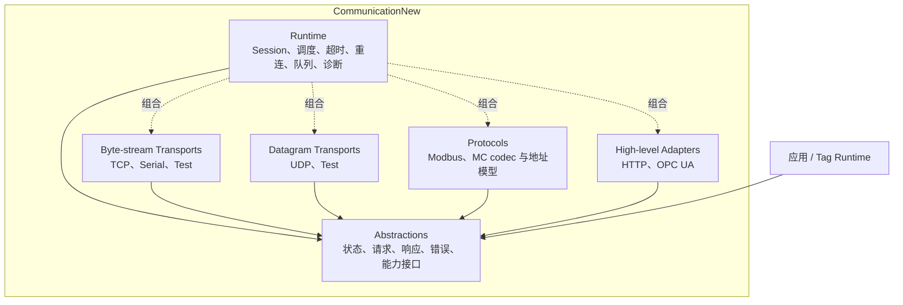

# CommunicationNew 架构优化方案

> 更新日期：2026-09-03  
> 范围：`Communication/CommunicationNew`  
> 口径：本文是 CommunicationNew 架构优化的唯一入口，合并代码审计、外部项目调研、目标架构、迁移顺序和验收标准。

## 1. 结论

CommunicationNew 已覆盖 Socket、Serial、Modbus、MC、HTTP、WebApi 和 OPC UA，具备统一设备接口、数据点模型、轮询器、转换器和帧工具。项目可以编译，但当前设计仍属于功能原型。团队继续增加协议前，应先修复以下问题：

1. `Core/CommunicationFactory.cs` 依赖所有具体协议，协议实现又依赖 Core，形成 `Core → Protocols → Core` 的逻辑依赖环。
2. `ICommunicationDevice` 混合连接、地址读写、原始流收发、客户端和服务端能力。多个实现用空结果或 `NotSupportedException` 满足接口。
3. timeout token 没有传到真实 IO；后台接收、重连和断开任务缺少统一所有者，释放过程也没有等待任务退出。
4. `ByteUtils.BigEndian` 是进程级可变状态。两个设备配置不同端序时会互相影响。
5. 协议类直接创建 Socket、SerialPort、HttpClient 和具体 SDK 类型，缺少可替换的测试边界。项目还没有测试工程。

架构优化采用四个逻辑边界：`Abstractions / Transports / Protocols / Runtime`。首期保留一个程序集，用命名空间和架构测试约束依赖；边界稳定后再决定是否拆分项目。

### 1.1 实施状态（2026-09-03）

本文件同时记录目标和实际进度。当前已完成架构地基与 Modbus TCP 首条竖切，不把尚未迁移的协议标记为完成。

| 范围 | 状态 | 已落地内容 |
| --- | --- | --- |
| P0 稳定性地基 | 基本完成 | 新增 24 个自动化测试；真实 IO 接收 timeout/cancellation；设备、轮询器和后台任务支持异步停止；清除无所有者的接收任务与无说明空异常；引入显式连接状态与 `TimeProvider` |
| P1 Modbus TCP 竖切 | 已完成首版 | `TcpByteStreamTransport → Pipe → ModbusTcpCodec → ConnectionSession`；旧 `ModbusTcpClientDevice` 作为兼容 adapter；固定报文、半包、loopback 与旧 API 测试通过；写操作不做隐式重试 |
| 组合与宿主解耦 | 已完成首版 | 核心改为普通 `net9.0`；Prism 移至 `CommunicationNew.Prism`；工厂改为参数类型注册表和 DI 组合根；新增协议不再修改 Core 的 switch |
| 数据转换 | 已完成首版 | 删除进程级 `ByteUtils.BigEndian`；按设备/点位注入不可变 `DataFormat`；覆盖 ABCD/BADC/CDAB/DCBA 与并发隔离测试 |
| P2 其余协议迁移 | 未完成 | Modbus RTU、MC、Serial 和原始 Socket 尚未统一迁移到新 Runtime；UDP datagram transport、HTTP/OPC UA 高层 adapter、日志/Metrics/Tracing 仍待实现 |
| P3 数据点与性能 | 未完成 | 质量化值、批量规划、按 scan rate 调度、有界队列压力测试和 Modbus TCP 多请求在途评估仍待实现 |

当前验证结果：`CommunicationNew.Tests` 24/24 通过；`CommunicationNew` 与 `CommunicationNew.Prism` 均为 0 个警告、0 个错误。后续实现应优先完成 P2，除修复缺陷外不要绕过新边界继续扩张旧基类。

## 2. 当前代码基线

| 编号 | 现状 | 影响 |
| --- | --- | --- |
| B1 | 55 个 C# 文件，约 4,135 行 | 规模允许渐进重构，无需一次性重写 |
| B2 | `ICommunicationDevice` 包含身份、事件、连接、地址读写和原始收发 | 调用方仍需识别具体协议能力 |
| B3 | `CommunicationFactory` 直接创建八类协议对象 | 新协议会修改 Core，核心无法独立演进 |
| B4 | Base 和各设备类分散管理 CTS、接收循环、重连和状态 | 断开、重连、释放之间可能发生竞态 |
| B5 | `ExecuteWithTimeoutAsync` 创建 linked token，但 `Func<Task<T>>` 不接收 token | timeout 无法取消实际操作 |
| B6 | 多处 `_ = Task.Run(...)`、fire-and-forget 断开和空 `catch` | 后台异常、任务泄漏和停止失败难以观测 |
| B7 | `DataPointAutoReader` 逐点串行读取，只有一个轮询周期 | 点位增加后请求数和周期线性增长 |
| B8 | 地址、长度和值使用 `string/int/object`；length 同时表示字节或寄存器 | 批量规划和类型校验缺少可靠语义 |
| B9 | `ByteUtils.BigEndian` 为公共静态可写属性 | 多设备并发转换存在交叉污染 |
| B10 | Framing 接口和实现没有生产调用点 | 继续扩张通用 pipeline 会增加闲置公共 API |
| B11 | 为 Prism 模块引用整个 Extension 项目并以 `net9.0-windows7.0` 为目标 | 通信内核与 Windows/宿主升级节奏绑定 |
| B12 | 没有 `CommunicationNew.Tests` | 重构缺少行为基线和竞态测试 |

本次 `dotnet build CommunicationNew.csproj --no-restore` 通过，结果为 0 个错误。构建输出包含 134 个警告，警告来自上游 Extension 项目。

## 3. 外部架构调研结论

### 3.1 .NET Pipelines

`System.IO.Pipelines` 将读取和解析分开，使用 `ReadOnlySequence<byte>` 处理半包与粘包，并通过 `PauseWriterThreshold`、`ResumeWriterThreshold` 控制内存。`PipeReader.AdvanceTo` 明确消费位置和检查位置。

CommunicationNew 应将 TCP、串口等连续字节流接入 Pipe。协议 codec 负责把字节序列解码为完整帧，transport 不理解 Modbus 或 MC。

来源：[Microsoft: System.IO.Pipelines](https://learn.microsoft.com/en-us/dotnet/standard/io/pipelines)、[dotnet/runtime PipeReader 源码](https://github.com/dotnet/runtime/blob/main/src/libraries/System.IO.Pipelines/src/System/IO/Pipelines/PipeReader.cs)

### 3.2 .NET Channels

有界 `Channel<T>` 支持等待、丢最新、丢最旧和丢当前写入四种满载行为。CommunicationNew 需要按数据语义选择策略：

| 数据路径 | 满载策略 |
| --- | --- |
| TCP/串口原始字节 | 等待消费者；超限后关闭异常连接，不能丢字节 |
| 协议事务请求 | 等待并受总超时控制，不能静默丢请求 |
| 完整协议帧 | 等待或连接级限流 |
| Tag 最新值通知 | 可按 Tag key 合并，但需要记录 dropped/coalesced 指标 |
| 报警、写入确认、审计事件 | 可靠传递，不采用丢旧策略 |

来源：[Microsoft: Channels](https://learn.microsoft.com/en-us/dotnet/core/extensions/channels)

### 3.3 SuperSocket 与 DotNetty

SuperSocket 使用 `PipelineFilter` 将 IO 字节流转换为应用包。DotNetty 用有序 handler pipeline 组织入站和出站处理。CommunicationNew 首期只需要 transport、codec 和 session 三个边界。TLS、日志、编解码等处理阶段出现重排需求后，再评估 handler pipeline。

来源：[SuperSocket PipelineFilter](https://docs.supersocket.net/v2-0/en-US/Implement-Your-PipelineFilter)、[DotNetty IChannelPipeline](https://github.com/Azure/DotNetty/blob/dev/src/DotNetty.Transport/Channels/IChannelPipeline.cs)

### 3.4 MQTTnet 与 Orleans

MQTTnet 在接口中声明连接、断开和收发操作的并发约束，并由独立流程协调重连。Orleans 用显式生命周期阶段执行启动和停止。CommunicationNew 也需要一个 session owner 串行处理 connect、disconnect、reconnect 和 dispose，并等待后台任务退出。

来源：[MQTTnet IMqttClient](https://github.com/dotnet/MQTTnet/blob/master/Source/MQTTnet/IMqttClient.cs)、[MQTTnet Connection Samples](https://github.com/dotnet/MQTTnet/blob/master/Samples/Client/Client_Connection_Samples.cs)、[Microsoft: Orleans lifecycle](https://learn.microsoft.com/en-us/dotnet/orleans/host/silo-lifecycle)

### 3.5 .NET DI 与插件

通信内核应通过构造注入接收依赖，并由宿主完成组合。首期使用 `IServiceCollection` 显式注册，不扫描任意 DLL。运行时投放插件成为明确需求后，再用 `AssemblyLoadContext` 和独立 contracts 程序集隔离依赖。

来源：[Microsoft: DI guidelines](https://learn.microsoft.com/en-us/dotnet/core/extensions/dependency-injection/guidelines)、[Microsoft: Plugin support](https://learn.microsoft.com/en-us/dotnet/core/tutorials/creating-app-with-plugin-support)

## 4. 目标架构



### 4.1 Abstractions

包含连接状态、endpoint、请求/响应、错误分类和能力接口。该边界禁止引用 Socket、SerialPort、NModbus、FluentModbus、OPC UA SDK、Prism 和具体协议实现。

建议的能力接口：

```csharp
public interface IConnection : IAsyncDisposable
{
    ConnectionState State { get; }
    ValueTask ConnectAsync(CancellationToken cancellationToken = default);
    ValueTask DisconnectAsync(CancellationToken cancellationToken = default);
}

public interface IRequestClient<TRequest, TResponse>
{
    ValueTask<TResponse> ExecuteAsync(
        TRequest request,
        CancellationToken cancellationToken = default);
}

public interface ISubscriptionSource<TUpdate>
{
    IAsyncEnumerable<TUpdate> ReadAllAsync(
        CancellationToken cancellationToken = default);
}
```

旧 `ICommunicationDevice` 进入冻结状态，由兼容 adapter 转发到新接口。团队不再向旧接口增加成员。

### 4.2 Transports

TCP 和串口属于连续字节流；UDP 属于保留消息边界的数据报。两个类别使用不同接口：

```csharp
public interface IByteStreamTransport : IAsyncDisposable
{
    PipeReader Input { get; }
    PipeWriter Output { get; }
    ValueTask OpenAsync(CancellationToken cancellationToken);
    ValueTask CloseAsync(CancellationToken cancellationToken);
}

public interface IDatagramTransport : IAsyncDisposable
{
    ValueTask<Datagram> ReceiveAsync(CancellationToken cancellationToken);
    ValueTask SendAsync(Datagram datagram, CancellationToken cancellationToken);
}
```

HTTP 和 OPC UA 使用 SDK 提供的高层连接、会话和订阅能力，不实现上述 transport。

### 4.3 Protocols

协议层包含帧编解码、地址值对象、请求响应关联和协议限制。codec 接受 `ReadOnlySequence<byte>`，不创建 Socket 或 SerialPort，也不负责重连。

每个协议 descriptor 声明：

- `MaxInFlightRequests`
- `SupportsPipelining`
- `IsWriteIdempotent`
- 最大 PDU 和地址范围

Modbus RTU 首期保持单请求在途。Modbus TCP 首期也采用单请求在途，稳定后依据压力测试决定是否通过 transaction id 开放并发。

### 4.4 Runtime

`ConnectionSession` 是连接和后台任务的唯一所有者。它负责：

- 状态机与 generation 标识；
- connect、disconnect、reconnect、dispose 串行化；
- 接收任务、请求队列和 supervisor 的启动与停止；
- 调用者取消、session shutdown、operation timeout 三类 token；
- 重试、背压和诊断。

建议状态：

```text
Disconnected → Connecting → Connected
                    └──────→ Faulted
Connected → Reconnecting → Connected / Faulted
Connected → Stopping → Disconnected / Disposed
```

手工断开设置“期望离线”，重连 supervisor 不应撤销用户操作。旧 generation 的接收任务完成后，也不能更新新 generation 的状态。

## 5. 错误、超时和重试

操作方法接收 `CancellationToken`，Runtime 将三个来源链接后传到真实 IO：

1. 调用者 token；
2. session shutdown token；
3. operation timeout token。

结果需要区分调用者取消、超时、连接失败、协议异常响应、地址错误和数据转换错误。转换失败不能返回合法的零值或 default。

Runtime 只重试团队明确标记为瞬态的错误。读操作可按策略重试；写操作默认不自动重试，除非协议或业务提供幂等保证。每次尝试设置 attempt timeout，整个操作设置 total timeout。重连策略与请求重试分开配置。

来源：[Microsoft: Cancel async tasks](https://learn.microsoft.com/en-us/dotnet/csharp/asynchronous-programming/cancel-async-tasks-after-a-period-of-time)、[Microsoft: .NET resilience](https://learn.microsoft.com/en-us/dotnet/core/resilience/)

## 6. 数据模型

每个协议定义不可变地址值对象，例如 `ModbusAddress`、`McAddress`。地址对象负责解析和格式化，协议请求使用明确单位，避免 `length` 同时代表字节和寄存器。

通信层输出质量化更新：

```text
ValueUpdate<T>
  Value
  Quality
  Timestamp
  SourceTimestamp?
  Error?
```

上层 Tag Runtime 负责 scan rate、scale、offset、deadband、报警和历史。CommunicationNew 不承担实时数据库、报警确认或历史归档。

端序使用不可变 `DataFormat` 或 codec options，按设备或点位传入 converter，覆盖 `ABCD/BADC/CDAB/DCBA`。删除公共静态 `ByteUtils.BigEndian`。

## 7. 可观测性

库代码使用 .NET 标准入口，不绑定具体 APM：

- `ILogger`：状态转换、重连、协议错误、队列满和后台任务退出；
- `Meter`：操作数、时延、连接数、重连次数、队列深度、丢弃量和收发字节；
- `ActivitySource`：排队、编码、发送、等待和解码阶段。

指标标签使用 protocol、transport、operation 和 outcome 等低基数维度。默认不记录 payload、完整地址或无限增长的 DeviceId。

来源：[Microsoft: .NET observability with OpenTelemetry](https://learn.microsoft.com/en-us/dotnet/core/diagnostics/observability-with-otel)

## 8. 测试策略

新增 `CommunicationNew.Tests`，按边界组织测试：

| 测试层 | 覆盖内容 |
| --- | --- |
| 纯单元测试 | 地址往返、四种端序、CRC、golden frame、非法长度、批量规划 |
| Codec 测试 | 任意切包与合包产生相同帧序列；损坏输入不无限缓存、不越界 |
| Transport contract tests | open/close 幂等、取消 read、远端关闭、部分写、dispose 后行为 |
| Runtime 测试 | connect/disconnect 竞态、旧 generation 晚完成、超时分类、队列满策略 |
| Loopback 集成测试 | TCP/UDP 半包、粘包、慢消费者、断线、重连和无响应服务端 |
| 兼容测试 | 旧 `ICommunicationDevice` 调用继续编译，事件和结果语义保持基线 |
| 长稳测试 | 分配量、P95/P99、队列上限、断线风暴和后台任务泄漏 |

Runtime 注入 `TimeProvider`，测试使用 `FakeTimeProvider` 推进虚拟时间，避免重连测试等待真实秒数。

来源：[Microsoft: Testing in .NET](https://learn.microsoft.com/en-us/dotnet/core/testing/)、[Microsoft: TimeProvider testing](https://learn.microsoft.com/en-us/dotnet/core/extensions/timeprovider-testing)

## 9. 实施路线

### P0：稳定性与测试地基

实施内容：

1. 创建测试工程，覆盖端序、CRC、地址、AutoReader 停止、TCP/Modbus 超时和旧 API。
2. 把 timeout token 传到真实 IO；保存并等待接收、重连和处理任务。
3. 引入 `IAsyncDisposable`、`ConnectionState`、generation 和 `TimeProvider`。
4. 删除空 `catch`，区分正常断开、远端断开、调用取消和超时。

验收标准：

- timeout 能取消真实 IO；
- dispose 完成后没有活跃接收或重连任务；
- connect/disconnect/reconnect 竞态测试通过；
- 测试无需等待真实重连间隔。

### P1：Modbus TCP 完整竖切

实施内容：

1. 建立 `TcpByteStreamTransport → Pipe → ModbusCodec → ConnectionSession`。
2. 使用有界请求队列；字节、请求和协议帧不采用丢弃策略。
3. 用 adapter 保留旧 `ModbusTcpClientDevice` 和 `ICommunicationDevice` 调用。
4. 用显式 descriptor/DI 注册取代 Modbus TCP 的核心 factory 分支。

验收标准：

- 随机切包和粘包测试通过；
- 慢消费者不会导致无限内存增长；
- 远端断开和旧 generation 晚完成不会破坏当前状态；
- 旧公开调用样例继续编译运行。

### P2：协议迁移与诊断

实施内容：

1. Modbus RTU 和 MC 复用 Runtime，保留各自 codec 和并发限制。
2. UDP 使用 datagram transport；HTTP 和 OPC UA 使用高层 adapter。
3. 将用户事件移出 IO loop，接入日志、Metrics 和 tracing。
4. 把 Prism 注册移到宿主或独立 integration 项目；核心目标框架改为普通 `net9.0`。

验收标准：

- 新增协议不修改 Abstractions 或 Runtime 主流程；
- 每个 transport 通过同一组 contract tests；
- 指标可以查看操作时延、失败、重连、积压和丢弃；
- 慢订阅者不阻塞收包循环。

### P3：性能与数据点能力

实施内容：

1. 引入强类型地址和值结果。
2. 实现相邻寄存器批量规划和按 scan rate 调度。
3. Tag 最新值按 key 合并，命令、确认和报警保持可靠传递。
4. 根据基准测试决定 Modbus TCP 的在途请求数。

验收标准：

- 100 个相邻寄存器按协议 PDU 上限合并；
- 批量读取的请求数和耗时有基准数据；
- 压力测试证明所有队列存在容量上限；
- 端序、地址和批量规划具有边界测试。

## 10. 后置项

以下内容不进入 P0 至 P2：

- S7 协议：核心边界稳定后，用 S7 adapter 验证扩展性。
- 动态插件：出现不停机投放协议的需求后，再引入 `AssemblyLoadContext`。
- 完整 handler pipeline：出现多个可重排处理阶段后再设计。
- 实时数据库、报警和历史：由 CommunicationNew 上层系统实现。

## 11. 兼容迁移

1. 冻结旧接口并记录公开 API 基线。
2. 新增 session、能力接口和 transport/codec 边界，不删除旧类。
3. 先迁移 Modbus TCP，再迁移 RTU、MC 和原始 Socket。
4. HTTP 和 OPC UA 使用高层 adapter，不穿过 byte-stream transport。
5. 新接口稳定后，为旧 API 添加包含替代说明的 `[Obsolete]`。
6. 发布 NuGet 时启用 Package Validation 或 ApiCompat。

团队不要在同一个版本同时执行命名空间迁移、协议重写、插件加载和 Tag 模型重做。每次迁移保留兼容 adapter，并用同一组测试核对旧 API 与新 API。

来源：[Microsoft: Breaking changes](https://learn.microsoft.com/en-us/dotnet/standard/library-guidance/breaking-changes)、[Microsoft: ApiCompat](https://learn.microsoft.com/en-us/dotnet/fundamentals/apicompat/overview)

## 12. 架构决策摘要

| 主题 | 决策 |
| --- | --- |
| 分层 | 使用四个逻辑边界，稳定后再拆程序集 |
| 统一接口 | 冻结 `ICommunicationDevice`，新增小型语义能力接口 |
| 传输 | 区分 byte stream、datagram 和高层 adapter |
| 生命周期 | 一个 `ConnectionSession` 拥有状态和后台任务 |
| 背压 | 按数据语义选择策略，协议字节与事务请求不丢 |
| 帧处理 | 先落地协议 codec，暂不扩张通用 handler 框架 |
| 装配 | 使用显式 DI 注册，Prism 留在宿主适配层 |
| 插件 | 动态加载后置 |
| 数据点 | 通信层输出质量化值，Tag/报警/历史归上层 |
| 新协议 | 核心稳定后再增加 S7 |
