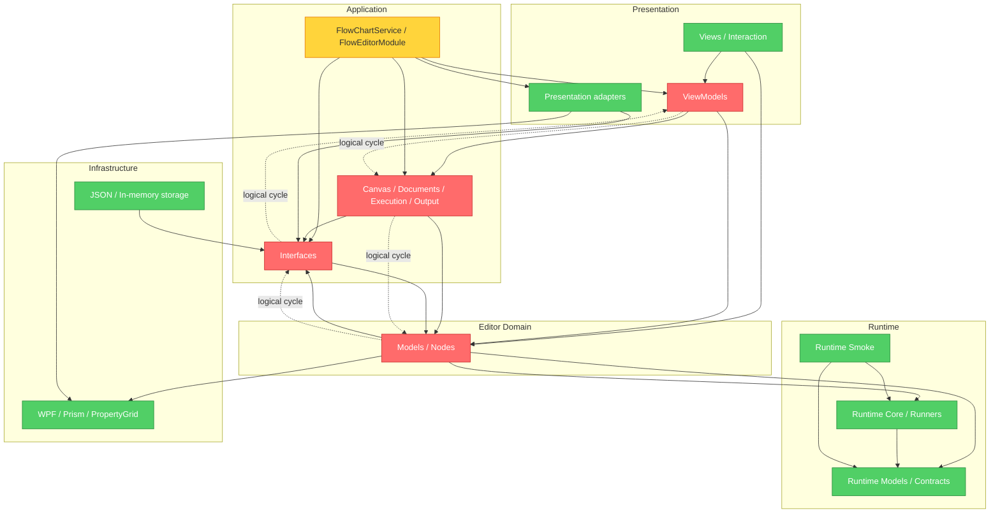

# Brooks-Lint Review

**Mode:** Architecture Audit  
**Scope:** `FlowEditor`、`FlowEditor.Runtime`、`FlowEditor.Tests`、`FlowEditor.PluginContractFixture` 与 `FlowEditorTest`（117 个生产 C# 文件；全项目复审）  
**Health Score:** 70/100  
**Trend:** 75 → 70（-5；本次范围从 P5 Runtime 扩展为整个 FlowEditor，不能直接解释为质量下降）

> 修复状态（2026-09-15）：R5 中节点上下文、通用接口层及执行/文档/画布应用模块对 ViewModel 的反向依赖均已移除；R3 端口值传递规则重复、R1 的两个千行文件热点及 R2 动态节点插件契约缺口也已完成修复。本报告分数保留审计时点结果。

Runtime 的程序集边界、基础设施 seam 和表现层交互拆分已经清晰；审计识别的主要结构问题均已落实修复，并由独立插件夹具及架构测试持续防回退。

---

## Module Dependency Graph

---

## Findings

### 🔴 Critical

**R5 Dependency Disorder — 编辑器领域仍通过 ViewModel 形成逻辑依赖环（已修复）**  
Symptom: `NodeModel` 持有 `IFlowChartService`；该接口公开 `ObservableCollection<NodeViewModel>` 和返回 `NodeViewModel` 的查找方法；`FlowCanvasSession` 同时依赖该接口、`NodeModel` 和 `NodeViewModel`。此外，`NodeModel` 直接引用 `System.Windows.Input` 与 `WPFCustomControls.PropertyGrid`。因此形成 `Models/Nodes → Interfaces → ViewModels → Services → Models/Nodes` 的逻辑环，且领域节点插件必须了解表现层类型。  
Source: *Clean Architecture* — Acyclic Dependencies Principle、Dependency Inversion Principle、Interface Segregation Principle。  
Consequence: 这些目录目前只能依靠同一 WPF 程序集相互可见，无法独立编译或逐层迁移；节点上下文或 ViewModel 的变化会跨越接口、画布会话和插件节点传播，也使第三方节点插件继承不必要的 UI 依赖。  
Remedy: 引入不包含 `NodeViewModel` 的节点上下文，例如只公开 `IReadOnlyList<NodeModel>`、连接集合、按 ID 查询 `NodeModel`、通知和文档重建；让 `FlowCanvasSession` 在该上下文与 `NodeViewModel` 之间适配。随后把 PropertyGrid 元数据与 `ICommand` 扩展移到编辑器 adapter 或独立 partial/descriptor，最后用独立程序集引用约束替代文本架构测试。

Remediation: 2026-09-15 已将节点上下文改为 `IEnumerable<NodeModel>` 与 `NodeModel? FindNode`，由 `FlowChartService` 的显式接口实现适配内部 ViewModel 集合。PropertyGrid 接口声明与 `ICommand` 扩展入口已集中到 `NodeModel.PropertyGrid.cs` 兼容桥；所用元数据、绑定 DTO 和接口来自纯 `net9.0` 的 `WPFCustomControls.PropertyGrid.Core` 契约程序集，而非 WPF 控件实现。复审发现的 `Interfaces → IFlowTabFactory → FlowChartViewModel` 残余逻辑环已通过把 factory seam 移入 ViewModel 层消除。执行、文档和模型级画布会话均已改用 `NodeModel` 快照并删除 `NodeViewModel` 反向依赖；画布投影转换集中在 `FlowCanvasViewModelAdapter`，组合根只负责装配这一边界。流程日志等级已迁为 Runtime 自有 `FlowLogLevel`，编辑器源码与项目文件均移除 `Extension` 直接依赖；结构化 `IFlowLogSink` 由服务构造注入，执行、校验、单步、恢复和循环事件保留匹配等级，DataManager 配置与枚举转换留给宿主 adapter。独立插件夹具与架构门禁共同锁定节点契约和依赖方向，本 finding 已完成修复。

### 🟡 Warning

**R1 Cognitive Overload — `NodeModel` 与 `FlowChartViewModel` 仍是高认知负载热点（已修复）**  
Symptom: `NodeModel.cs` 为 1,063 行，同时管理执行状态、端口生成、属性反射、节点动作、数据绑定、流程生命周期和 PropertyGrid 扩展；`FlowChartViewModel.cs` 为 1,026 行，同时管理选择、拖动、复制粘贴、节点/容器编辑、运行、文件、撤销、连线、缩放和导出。两者均跨越多个抽象层级和变化原因。  
Source: *Refactoring* — Large Class、Divergent Change；*A Philosophy of Software Design* — Cognitive Load、Information Leakage。  
Consequence: 新增端口、容器或编辑命令时，维护者仍需理解大范围状态耦合；局部修改更容易误触撤销快照、选择状态或生命周期约束，拆分后的深模块收益无法完全传递到调用端。  
Remedy: 优先把 `FlowChartViewModel` 按现有 region 拆为命名明确的 partial 文件，并把“容器成员归属与越界连线清理”下沉为独立编辑模块；对 `NodeModel` 先提取数据绑定与端口配置实现，保持节点执行契约和生命周期入口不变，以现有 291 项测试作为 characterization baseline。

Remediation: 2026-09-15 已将 `FlowChartViewModel` 的执行/恢复、文档/撤销、连线提交、表现层入口、选择/拖动和剪贴板事务迁入命名 partial 文件；容器归属规则已下沉到平台无关的 `FlowCanvasSession`，主文件从 1,026 行降至 301 行。`NodeModel` 的数据绑定、生命周期、端口集合/配置、端口查询、运行时属性同步及反射缓存分别迁入 `NodeModel.DataBindings.cs`、`NodeModel.Ports.cs` 和 `NodeModel.PortValues.cs`，主文件从 1,063 行降至 330 行。架构测试锁定职责位置与主文件行数，本 finding 已完成修复。

**R3 Knowledge Duplication — 端口数据传递规则存在两份实现（已修复）**  
Symptom: `FlowChartExecutionEngine.FillInputPorts` 与 `LoopContainerNode.TransferBoundaryData` 分别实现端口查找、声明类型验证、运行时值验证、异常消息和赋值；两处都调用 `IsTypeCompatibleWith`、`IsCompatible` 并直接设置 `targetPort.Value`。  
Source: *The Pragmatic Programmer* — DRY；*A Philosophy of Software Design* — Information Leakage。  
Consequence: 普通连线与循环容器边界可能在空值、类型转换、追踪或错误文本上逐渐产生不同语义；每次修改端口传值规则都需要同步两处并执行不同测试组。  
Remedy: 在 Runtime 中提取一个端口值传递函数，统一返回或抛出类型验证结果；执行引擎负责追加 journal，循环容器只负责筛选跨边界连接并调用该函数。

Remediation: 2026-09-14 已新增 Runtime `PortValueTransfer`，集中端口查找、声明类型验证、运行时值验证、异常诊断和值写入。`FlowChartExecutionEngine` 仅在成功传递后记录 Journal，`LoopContainerNode` 仅保留跨边界及非 Flow 端口筛选；直接行为测试与架构门禁防止规则再次复制。

**R2 Change Propagation — 动态节点插件兼容性缺少独立契约验收（已修复）**  
Symptom: 组合入口通过 `Assembly.Load("FlowNodes")` 动态发现节点，架构文档承诺现有节点插件兼容；当前测试主要覆盖内置节点和 `ReflectionNodeFactory`，没有以独立插件程序集验证加载、`OnAttached(IFlowChartService)`、文档 round-trip 与一次实际执行。  
Source: *Software Engineering at Google* — Hyrum's Law、Backward Compatibility；*Working Effectively with Legacy Code* — Characterization Tests。  
Consequence: `NodeModel`、`IFlowChartService` 或反射构造规则发生源代码兼容但二进制不兼容的变化时，FlowEditor 测试仍可能全部通过，问题只会在部署外部节点包后出现。  
Remedy: 新增最小独立插件契约项目，引用发布产物而不是项目内部类型；CI 中验证插件程序集加载、节点创建、附加/卸载、旧文档还原和无界面执行，并把该项目纳入发布门禁。

Remediation: 2026-09-15 已新增独立 `FlowEditor.PluginContractFixture`。`FlowEditorTest` 通过 `ReferenceOutputAssembly="false"` 只构建该项目，测试代码不引用夹具类型，而是从构建产物执行 `Assembly.LoadFrom`；现已覆盖工具箱发现、`ReflectionNodeFactory` 创建、附加/卸载回调、旧式短程序集类型名文档还原及无界面执行。架构测试禁止该验收退化为直接类型引用，本 finding 已完成修复。

---

## Testability Seam Assessment

文件存储、UI Dispatcher、节点编辑器、通知、导出和标签页创建均已有生产与测试 adapter；Runtime Smoke 证明执行程序集可以脱离 WPF 运行，独立插件夹具则验证动态节点程序集的发现、物化、生命周期、文档兼容和执行 seam。这些 seam 状态健康。

## Conway's Law Check

未提供团队所有权信息，因此无法判断当前模块边界是否造成跨团队协调成本，本次不计入 finding 或评分。

---

## Summary

`IFlowChartService` 和通用接口层对具体 ViewModel 的暴露、端口传值规则重复、两个千行热点、动态插件契约缺口及 PropertyGrid 兼容入口散落均已在审计后消除。下一阶段应继续移除执行、文档和画布模块对 `NodeViewModel` 的反向依赖，再处理插件 SDK 与节点发现目录；Runtime 执行引擎虽超过千行，但由较小接口封装且职责集中，本次不按长度单独判定为问题。
