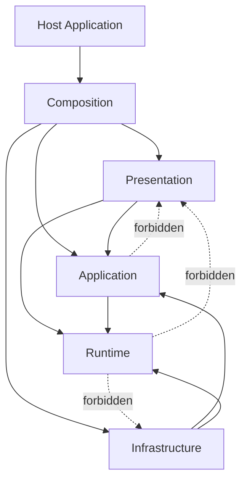

# FlowEditor 架构优化计划

> 状态：核心优化已完成，进入维护阶段
> 基线日期：2026-09-10  
> 范围：`FlowEditor` 类库及 `FlowEditorTest` 测试项目  
> 当前验证基线：301 个测试全部通过（新增 Runtime 程序集、执行引擎日志 seam、执行/文档/画布/输出门面收缩及视口/连线/选择交互模块依赖护栏、函数文档、对话框及导出 seam 门禁、节点生命周期、结构化容器恢复、输出栏过滤、节点上下文领域模型契约、统一端口值传递规则、ViewModel 职责分级、容器成员归属及 NodeModel 数据绑定职责回归测试；旧版 `SubFlowNode` 删除后同步移除 5 个失效用例）

## 1. 文档目的

本文档汇总 FlowEditor 当前已确认的架构问题、目标结构、界面文件拆分方案、注释规范、分阶段实施步骤以及每个阶段的验收条件。

本计划的核心目标不是单纯减少文件行数，而是形成以下稳定依赖方向：

```text
Presentation -> Application -> Runtime/Domain
                         |
                         v
                   Infrastructure
```

最终应满足：

1. 流程运行时不依赖 WPF、Prism、ViewModel 或具体窗口。
2. 视图只负责呈现、坐标、命中测试及 WPF 生命周期。
3. 业务规则只有一个实现位置，ViewModel 只负责编排。
4. 复杂行为隐藏在小而稳定的接口之后。
5. 公共成员和所有函数都有可由工具验证的注释。
6. `.flow`、`.flows` 文件及现有节点插件保持兼容。

## 2. 当前架构基线

### 2.1 当前目录

```text
FlowEditor/
|- Core/          执行、编译、校验、持久化、反射工厂、日志上下文
|- Interfaces/    服务接口
|- Models/        流程、节点、端口、连线及文档模型
|- Nodes/         内建流程控制节点
|- Services/      编辑、执行、持久化、输出、对话框等服务
|- ViewModels/    容器、画布、节点及工具箱 ViewModel
|- Views/         WPF 视图、窗口、连线渲染与交互
|- Converters/
|- Resources/
|- FlowEditorModule.cs
`- ARCHITECTURE.md
```

### 2.2 已确认的主要问题

| 编号 | 问题 | 主要证据 | 优先级 |
| --- | --- | --- | --- |
| A-01 | `Core` 依赖 `ViewModels` | `FlowChartExecutionEngine`、`ExecutionGraphScope`、`FlowChartPersistenceService` | P0 |
| A-02 | `Nodes` 依赖 WPF `Views` | `ToolBlockNode`、`SwitchNode` 直接创建窗口；`LoopNode` 直接弹 MessageBox | P0 |
| A-03 | `Services` 与 `ViewModels` 双向耦合 | 已解决：`IFlowChartService` 改为 `NodeModel` 视角，`FlowChartService` 以显式接口实现适配画布 ViewModel | P0（已完成） |
| A-04 | `NodeModel` 职责过多 | 约 997 行，同时处理执行、端口、反射、属性面板绑定、画布服务和命令 | P1 |
| A-05 | `FlowChartService` 职责过多 | 约 797 行，同时处理执行、文件、撤销、缩放、日志、Dispatcher 和节点集合 | P1 |
| A-06 | `FlowChartView.xaml.cs` 职责过多 | 约 697 行，包含渲染、选择、连线、右键菜单、平移、缩放和拖放 | P1 |
| A-07 | 容器 XAML 过大 | `FlowChartContainerView.xaml` 约 655 行，工具栏约 227 行、工具箱约 203 行 | P1 |
| A-08 | 架构文档与实现不一致 | `ARCHITECTURE.md` 声明单向依赖，但实际存在多组反向依赖 | P1 |
| A-09 | XML 文档注释没有构建门禁 | 179 个唯一公共成员缺少 XML 注释，另有 2 个无效 `cref` | P1 |
| A-10 | 测试用 `null!` 绕过构造依赖 | 多个测试直接构造 `FlowChartService(null!, engine, null!)` | P2 |
| A-11 | 文档模型映射重复 | 连线文档映射在多个持久化路径重复实现 | P2 |
| A-12 | 输出链路泄漏 WPF 细节 | `FlowChartService` 直接访问 `Application.Current.Dispatcher` | P2 |

### 2.3 当前值得保留的设计

以下模块已有较好的深度和局部性，不应在重构中无理由改写：

- `ConnectionService`：集中连接校验和连接计划，返回结果而不是直接操作界面。
- `CompiledFlowGraph`：集中图编译和索引构建。
- `FlowProgram` / `FlowInstance`：已经建立编辑状态与运行实例状态隔离的基础。
- `DebugController`：用异步门闩表达调试暂停。
- `ExecutionJournal`：集中记录执行事件。
- `INodeFactory`：反射创建和宿主创建之间已有实际 seam。
- 当前交互性能优化：缓存端口位置、复用 Path、延迟属性面板刷新。

## 3. 设计原则

### 3.1 深模块原则

一个模块应通过较小的接口隐藏较多实现复杂度。接口不仅包含方法签名，也包括调用顺序、错误模式、线程要求和性能约束。

判断模块是否值得存在时使用“删除测试”：如果删除模块后，其复杂度会重新散落到多个调用方，说明模块有价值；如果复杂度直接消失，模块可能只是浅层转发。

### 3.2 seam 与 adapter 原则

只在行为确实需要替换的地方建立 seam：

| seam | 生产 adapter | 测试 adapter | 是否需要接口 |
| --- | --- | --- | --- |
| UI 线程封送 | WPF Dispatcher | Immediate/Recording Dispatcher | 是 |
| 文件持久化 | 本地文件存储 | 内存文档存储 | 是 |
| 节点编辑器 | WPF Window Launcher | Recording Launcher | 是 |
| 标签页创建 | Prism Factory | Test Factory | 是 |
| 外部日志落盘 | Extension 日志 adapter | In-memory Log Sink | 是 |
| 图执行算法 | `FlowChartExecutionEngine` | 同一纯算法实现 | 否 |
| 连接规划 | `ConnectionService` | 同一纯算法实现 | 否 |
| 视口缩放 | WPF Viewport Behavior | 直接测试该行为 | 暂不需要 |

禁止因为“以后可能替换”而为每个类增加接口。一个生产实现加一个真实测试实现，才是有价值的 seam。

### 3.3 依赖规则

- `Runtime/Domain` 禁止引用 `System.Windows*`、Prism、ViewModels、Views、MaterialDesign 和 PropertyGrid。
- `Application` 可以引用 Runtime/Domain，但不能引用具体 WPF 类型。
- `Presentation` 可以引用 Application 和 Runtime/Domain。
- `Infrastructure` 实现 Application 定义的外部 seam。
- 只有 `Composition` 可以解析容器、注册具体 adapter 或调用 `Resolve<T>()`。
- 节点不得决定使用哪个窗口、MessageBox 或文件对话框。

## 4. 目标架构

### 4.1 最终项目结构

```text
FlowEditor.Runtime/                 net9.0
|- Domain/
|  |- FlowNode.cs
|  |- PortModel.cs
|  |- ConnectionModel.cs
|  `- NodePolicies.cs
|- Execution/
|  |- INodeExecutable.cs
|  |- FlowChartExecutionEngine.cs
|  |- CompiledFlowGraph.cs
|  |- LoopNormalizer.cs
|  |- ExecutionJournal.cs
|  `- DebugController.cs
|- Validation/
|  `- FlowValidator.cs
|- Programs/
|  |- FlowProgram.cs
|  |- FlowInstance.cs
|  `- FlowRecursionGuard.cs
`- Documents/
   `- Runtime document contracts

FlowEditor/                         net9.0-windows
|- Application/
|  |- Editing/
|  |  |- FlowEditorSession.cs
|  |  |- ConnectionService.cs
|  |  `- UndoRedoService.cs
|  |- Documents/
|  |  |- FlowDocumentMapper.cs
|  |  `- FlowContainerDocumentCoordinator.cs
|  `- Contracts/
|     |- IFlowDocumentStore.cs
|     |- IFlowTabFactory.cs
|     |- INodeEditorLauncher.cs
|     |- IUiDispatcher.cs
|     `- IFlowLogSink.cs
|- Infrastructure/
|  |- Persistence/FileFlowDocumentStore.cs
|  |- Wpf/WpfUiDispatcher.cs
|  |- Wpf/WpfNodeEditorLauncher.cs
|  |- Wpf/DialogService.cs
|  |- Wpf/ExportService.cs
|  `- Logging/ExtensionFlowLogSink.cs
|- Presentation/
|  |- Container/
|  |- Canvas/
|  |- Nodes/
|  |- Behaviors/
|  |- Menus/
|  `- Resources/
`- Composition/
   `- FlowEditorModule.cs
```

在依赖环被清除前，先在现有项目内按上述目录和命名空间整理；不要一开始就拆程序集。

### 4.2 目标依赖图



## 5. 视图与文件拆分方案

### 5.1 `FlowChartContainerView.xaml`

目标：容器只描述整体布局，不实现工具箱、命令栏和输出行为。

```text
Views/
|- FlowChartContainerView.xaml
|- FlowChartContainerView.xaml.cs
|- FlowCommandBarView.xaml
|- FlowToolboxView.xaml
`- FlowToolboxView.xaml.cs

ViewModels/Commands/
|- FlowChartContainerViewModel.Commands.cs
`- FlowChartViewModel.Commands.cs
```

拆分决策：

| 区域 | 决策 | 原因 |
| --- | --- | --- |
| 顶部工具栏 | 立即拆成 `FlowCommandBarView` | 约 227 行，职责独立，只依赖命令和状态绑定 |
| 左侧工具箱 | 立即拆成 `FlowToolboxView` | 模板复杂且包含搜索、展开、双击和拖放 |
| 输出栏 | 第一阶段保留在容器 | 当前视觉只有约 18 行，单独建 UserControl 暂时是浅模块 |
| 属性栏 | 保持现状 | 已由 `PropertyGridHost` 封装 |
| 标签页宿主 | 保持现状 | 当前组合很薄，无需再包一层 |
| 局部样式 | 就近放入所属子视图 | 样式当前没有第二个调用方，避免创建浅 ResourceDictionary |

### 5.2 菜单

当前没有顶部 `<Menu>` 菜单栏。“菜单”实际是 `FlowChartView.xaml.cs` 动态创建的节点和画布右键菜单。

实施决策：

1. 菜单结构放入 `FlowChartView.xaml` 的资源，出现第二个使用方后再提取共享字典。
2. 菜单项、快捷键和工具栏共用同一命令实例。
3. 动态权限、节点类型和执行状态通过绑定、DataTrigger 或菜单项集合模型表达。
4. 不在 code-behind 中逐个 `new MenuItem()`。
5. 若以后增加顶部菜单栏，也复用同一命令，不复制处理逻辑。

### 5.3 命令放置规则

- 只由一个宿主处理的视觉树操作使用子视图显式事件 seam，由最近的宿主视图完成；不创建只承担一次转发的全局 `RoutedUICommand`。
- 只有确实需要多处理器路由、WPF 命令手势或跨视觉层复用时，才在 `Presentation/Commands` 声明路由命令。
- 多标签容器用例命令放入 `FlowChartContainerViewModel.Commands.cs`。
- 单流程编辑、执行和文档命令放入 `FlowChartViewModel.Commands.cs`。
- XAML 继续绑定原有公开命令名，不创建只做转发的命令分组对象。
- `NodeModel` 中遗留的 `ICommand` 属于领域层泄漏，随 Phase 3 的 descriptor + command adapter 一并迁移。

### 5.4 工具箱拖放

明确唯一职责：

- `FlowToolboxView` 只负责发起标准 WPF DragDrop，DataObject 中携带 `NodePaletteItem`。
- `FlowChartView` 只负责接收 Drop、坐标换算并调用 ViewModel。
- 删除容器层 `PreviewMouseLeftButtonUp` 模拟释放的路径前，先补充拖放回归测试。
- 双击添加仍由工具箱触发，但实际添加动作通过命令完成。

### 5.5 `FlowChartView.xaml.cs`

目标：保留一个负责订阅/解绑和组合的薄 code-behind，把独立交互变成有清晰接口的模块。

```text
Presentation/Canvas/
|- FlowChartView.xaml
|- FlowChartView.xaml.cs
|- Rendering/
|  |- NodeVisualManager.cs
|  `- ConnectionRenderer.cs
|- Behaviors/
|  |- CanvasSelectionBehavior.cs
|  |- CanvasConnectionBehavior.cs
|  |- CanvasViewportBehavior.cs
|  `- CanvasDropBehavior.cs
`- Menus/
   `- FlowChartContextMenus.xaml
```

职责分配：

- `NodeVisualManager`：节点视觉树缓存、节点新增/删除和订阅清理。
- `ConnectionRenderer`：连线几何、Path 复用、命中区域和样式选择。
- `CanvasSelectionBehavior`：单选、多选、框选和选择矩形。
- `CanvasConnectionBehavior`：连线拖动、候选端口缓存、吸附和完成连接。
- `CanvasViewportBehavior`：平移、滚轮缩放、自适应视图。
- `CanvasDropBehavior`：工具箱 Drop 和画布坐标换算。

可以先使用 `partial` 文件降低一次迁移风险，但 `partial` 只解决文件长度，不解决模块职责；最终仍应提取上述模块。

### 5.5 输出栏

第一阶段不为减少 XAML 行数而拆 UserControl，先修复数据链路：

```text
FlowChartExecution -> IFlowLogSink
                   -> FlowOutputBuffer
                   -> IUiDispatcher
                   -> FlowOutputViewModel
                   -> Output View
```

要求：

- `FlowChartService` 不直接访问 `Application.Current.Dispatcher`。
- 缓冲、截断、节流属于 `FlowOutputBuffer` 实现。
- UI 自动滚动改为 Attached Behavior，不使用容器事件处理器。
- 输出区域已因一键清空需求提取为 `FlowOutputPaneView`；后续过滤、搜索、暂停滚动或虚拟化继续在该视图内演进。
- 若日志量继续增长，考虑 `ObservableCollection<LogEntry>` 加虚拟化列表，避免反复替换完整字符串。

## 6. 运行时解耦方案

### 6.1 消除 `Core -> ViewModels`

最小迁移路径：

1. 在 `INodeExecutable` 增加引擎实际需要的计数能力：`CurrentRunCount`、`RunSequence`。
2. `FlowChartExecutionEngine` 删除对 `NodeViewModel` 和 `NodeModel` 的具体类型判断。
3. `ExecutionGraphScope` 改为接收 `NodeModel`，或改成受 `INodeExecutable` 约束的泛型模块。
4. `FlowChartService` 调用执行引擎时传入 `Nodes.Select(node => node.Model)`。
5. 调试暂停和执行顺序通过节点 ID 映射回 `NodeViewModel`。
6. `NodeViewModel` 删除 `INodeExecutable`、`INodeFaultPolicy`、`ILoopControlNode` 转发实现。
7. `FlowChartPersistenceService.BuildDocument` 改为接收 `NodeModel`，不再接收 `NodeViewModel`。
8. `FlowValidator` 和 `ExecutionGraphScope` 禁止引用 `FlowEditor.ViewModels`。

验收：`rg "FlowEditor.ViewModels" FlowEditor/Core` 无结果。

### 6.2 消除 `Nodes -> Views`

具体迁移：

- `ToolBlockNode.OpenInternalFlow()`：迁移到 `INodeEditorLauncher` 的 WPF adapter。
- `SwitchNode.EditDispatchRules()`：迁移到同一 launcher，根据节点类型选择编辑器。
- `LoopNode.PreviewParams()`：节点暴露参数摘要，表现层负责 MessageBox 或侧栏显示。
- `NodeAction` 只描述动作标识、标题、图标和可执行状态，不持有窗口创建逻辑。

建议接口：

```csharp
public interface INodeEditorLauncher
{
    bool CanOpen(NodeModel node);
    void Open(NodeModel node);
}
```

生产 adapter 打开 WPF 窗口；测试 adapter 记录打开请求。

验收：`rg "FlowEditor.Views|System.Windows" FlowEditor/Nodes` 无结果。

### 6.3 拆解 `NodeModel`

按知识所有权拆分，而不是按方法数量拆分：

| 新模块 | 隐藏的实现 | 对调用方的接口 |
| --- | --- | --- |
| `FlowNode` | 状态、计数、错误策略、执行契约 | 执行所需最小属性和 `ExecuteAsync` |
| `NodePorts` | 内建/自定义端口、缓存、增删改 | 查询端口和端口配置命令 |
| `NodePropertyBinder` | 反射缓存、输入输出属性同步 | `SyncInputs`、`SyncOutputs` |
| `NodeBindingCoordinator` | 上游遍历、绑定建立和删除 | 属性面板需要的绑定用例 |
| `NodeActionDescriptor` | 动作元数据 | 标题、图标、命令标识 |

`IDataBindingProvider` 是 PropertyGrid 的表现层接口，不应继续由 Runtime 中的节点直接实现。短期可通过 adapter 包装 `NodeModel`，长期由 `NodeBindingCoordinator` 提供。

## 7. 应用模块拆分

### 7.1 `FlowChartService`

不要把原大类机械拆成多个相互转发的浅类。目标模块如下：

| 模块 | 负责 | 不负责 |
| --- | --- | --- |
| `FlowEditorSession` | 节点/连线编辑状态、修改标记、撤销边界 | 文件对话框、WPF Dispatcher、渲染 |
| `FlowExecutionSession` | 一次运行、停止、循环、调试状态协调 | 文件保存、缩放、窗口 |
| `FlowDocumentCoordinator` | 当前文档保存/加载用例 | JSON 细节、文件对话框实现 |
| `FlowOutputBuffer` | 日志缓冲、截断、节流 | WPF `Application` |
| `ViewportState` | 缩放值、画布尺寸及约束 | 查找 VisualTree |

这些模块可以是具体类。只有文件、UI 调度、窗口、日志落盘和标签创建等真实 seam 需要接口。

### 7.2 持久化

拆成两个知识所有者：

```text
FlowDocumentMapper       Node/Connection <-> Document DTO，纯内存
IFlowDocumentStore       Save/Load 文档
  |- FileFlowDocumentStore
  `- InMemoryFlowDocumentStore
```

统一以下重复映射：

- `ConnectionModel -> ConnectionDocumentModel`
- `ConnectionDocumentModel -> ConnectionModel`
- `NodeModel -> NodeDocumentModel`
- `NodeDocumentModel -> NodeModel`

文件格式约束：

- 保留现有字段名和 camelCase。
- 未经迁移器不得修改 `Version = "1.0"` 的语义。
- 新字段必须提供向后兼容默认值。
- 保存、加载、快照、单流程和多流程必须复用同一 mapper。

### 7.3 Prism 容器

- `FlowEditorModule` 是唯一 composition root。
- ViewModel 不保存 `IContainerProvider`。
- `FlowChartContainerViewModel` 注入 `IFlowTabFactory`。
- `FlowChartContainerDocumentService` 注入同一个 factory。
- `ToolboxService` 使用已经构建好的节点 descriptor/factory，不直接暴露容器。
- `ReflectionNodeFactory` 使用实例注册表；Prism 回退解析只存在于 `PrismNodeFactory` adapter，不允许恢复全局静态 resolver。

## 8. 注释完整性计划

### 8.1 注释范围

项目采用“所有函数必须有文档注释”的规则，范围明确为：

- public、protected、internal、private 方法。
- 构造函数。
- 运算符和转换函数。
- WPF 事件处理器。
- 接口实现和 override 方法。

不要求单独注释：属性访问器、lambda、匿名函数、编译器生成成员。复杂局部函数应提升为命名方法并补充注释。

### 8.2 注释内容

- `<summary>`：说明意图和职责，不复述方法名。
- `<param>`：说明单位、允许范围、是否允许 null 和所有权。
- `<returns>`：说明结果语义，尤其是 `bool`、nullable 和集合。
- `<exception>`：说明调用方可预期处理的异常。
- `<remarks>`：说明线程要求、调用顺序、性能或兼容性约束。
- 接口实现和 override 优先使用 `<inheritdoc/>`，只有行为变化时补充说明。
- 事件处理器应写明触发来源和副作用。
- catch 不得为空；必须记录、转换、明确忽略理由或让异常传播。

### 8.3 工具门禁

1. 在 `FlowEditor.csproj` 启用：

   ```xml
   <GenerateDocumentationFile>true</GenerateDocumentationFile>
   ```

2. 修复当前 179 个唯一 CS1591 和 2 个无效 `cref`。
3. 在 `.editorconfig` 中将 `CS1591` 提升为 error。
4. public/protected 由编译器门禁。
5. private/internal 使用 StyleCop SA1600 或仓库级 Roslyn analyzer 门禁；实施时明确排除自动生成文件。
6. CI 执行文档构建，不允许通过 `NoWarn=1591` 绕过。

建议按目录清理：

1. Runtime/Core。
2. Interfaces/Application contracts。
3. Nodes。
4. ViewModels。
5. Views 和 Converters。

## 9. 架构约束测试

在尚未拆成独立程序集前，增加临时架构约束测试；程序集拆分后优先依赖编译器约束。

必须验证：

- Core/Runtime 不引用 ViewModels、Views、Prism、WPF。
- Nodes 不引用 Views 或窗口类型。
- Application 不引用 Presentation。
- `Resolve<T>()` 只允许出现在 Composition。
- 持久化接口不暴露 ViewModel。
- Runtime 项目目标框架不包含 `-windows`，且 `UseWPF` 为 false。
- 每个公共成员有合法 XML 文档。

不要为测试暴露私有实现。重构后的测试应通过模块接口断言可观察结果。

## 10. 测试与验收矩阵

| 改动 | 必跑测试 | 需要补充 |
| --- | --- | --- |
| 工具栏/工具箱拆分 | 全部测试、WPF 加载测试 | 命令绑定、拖放、双击添加 smoke test |
| FlowChartView 行为拆分 | 交互性能、NodeDrag、ConnectionOperation | 框选、平移、右键菜单生命周期测试 |
| Core 去 ViewModel | ExecutionEngine、CompiledGraph、RuntimeSeparation、Stress | Core 禁止依赖 ViewModel 的架构测试 |
| 节点去窗口 | Switch、Loop、BranchMerge | Recording NodeEditorLauncher 测试 |
| 服务拆分 | FlowChartServiceExecution、StepExecution、FaultTolerance | 每个深模块接口行为测试 |
| 持久化统一 | Png 以外的全部文档测试 | `.flow`/`.flows` 旧样本兼容及 round-trip |
| 输出链路 | FlowChartServiceExecution | 节流、截断、线程封送和关闭 Dispatcher 测试 |
| Runtime 拆项目 | RuntimeSeparation、Stress、MultiLoop | 非 WPF 控制台宿主 smoke test |

每一批必须满足：

1. `dotnet test FlowEditorTest/FlowEditor.Tests.csproj --no-restore` 全部通过。
2. 不新增编译警告。
3. 不改变 `.flow` / `.flows` 输出结构，除非有显式迁移测试。
4. 性能测试不得明显退化。
5. 当前用户未提交的性能改动必须保留。

## 11. 分阶段实施顺序

### Phase 0：安全护栏和文档基线（S）

- [x] 更新 `ARCHITECTURE.md`，区分当前和目标架构。
- [x] 修复无效 `cref`。
- [x] 为 Runtime 与 WPF 项目启用 XML 文档生成，并将 CS1591/CS1570/CS1573/CS1574/CS1587 提升为构建错误。
- [x] `FlowEditor.Runtime` 与 WPF 项目均已清零文档警告；WPF 项目本轮准确清理 84 个唯一公共成员缺口（WPF 临时项目会重复输出同一告警）。
- [x] 补齐单画布 ViewModel、容器 ViewModel 和画布视图的全部函数摘要，并以源码架构测试禁止回退。
- [x] 补齐节点基类、并行分叉与分支汇聚的函数摘要；删除动态端口增删后的重复缓存失效通知，并纳入同一门禁。
- [x] 补齐对话框、连线规划和控制台路由模块的函数摘要；删除无调用的警告框入口，并把通用消息框收回 WPF adapter，使 `IDialogService` 不再依赖 WPF 类型。
- [x] 补齐结构化容器、循环、分发和基础流程控制节点的全部函数摘要，并将 11 个流程控制节点文件加入自动门禁；保留仍承担旧 `.flow` 兼容的端口清理逻辑。
- [x] 补齐节点、容器、连线和端口视图的函数摘要；修复门禁对泛型返回类型及泛型方法的漏检，并将 7 个视图交互文件纳入门禁。
- [x] 清零全部生产 C# 文件的函数注释缺口，并将门禁从文件白名单升级为自动扫描整个项目；删除 4 个零引用转换器，`IExportService` 从 6 个入口收缩为 2 个实际对话框导出意图。
- [x] 补齐函数以外的公共类型、属性、字段和事件注释。
- [x] 增加架构依赖约束测试（以 allowlist 锁定现有债务）。
- [x] 保存测试、构建和性能基线（模块项目可构建，260 个测试通过；旧 `Flow.sln` 含失效项目路径，不能作为当前入口）。

验收：行为零变化，260 个当前测试通过；文档构建无 CS1591/CS1574 后完成本阶段。

### Phase 1：表现层拆分（M）

- [x] 提取 `FlowCommandBarView`；PNG 导出由命令栏通过显式事件交给最近的宿主视图，避免一次性 Routed Command 和把视觉元素作为 ViewModel 命令参数。
- [x] 提取 `FlowToolboxView`，由该视图封装展开、双击添加和标准 WPF DragDrop 发起。
- [x] 清理容器 ResourceDictionary，将命令栏和工具箱样式就近放入各自视图。
- [x] 将输出自动滚动迁为 `TextBoxAutoScrollBehavior` Attached Behavior。
- [x] 将画布和节点右键菜单迁至 XAML，代码仅提供当前节点的只读菜单上下文。
- [x] 为工具栏、工具箱和菜单补充 WPF smoke test。
- [x] 删除无调用方的单画布 `NewFlowCommand`、`ZoomResetCommand` 和一次性 `FlowChartRoutedCommands`；多标签新增流程命令保留在容器 ViewModel。
- [x] 收缩 `IFlowChartService` 门面：删除无消费者的 `ZoomReset`、`FlushLog` 和公开 `ClearNodes` 转发；内部画布模块继续自行复用缩放复位与节点清理实现。
- [x] 清理单画布 ViewModel 的旧入口：删除无调用方的 `AddNodeModel`、空 `UpdateConnectionEndPoint`，并移除 `StartConnection` 未使用的坐标参数。
- [x] 提取 `Views/Interaction/FlowViewportController`，集中接管平移手势、鼠标定位缩放、自适应视图及其状态；`FlowChartView` 不再声明视口事件处理器或平移字段。
- [x] 提取 `Views/Interaction/FlowConnectionDragController`，集中接管临时连线绘制、候选端口吸附、坐标缓存、鼠标完成事件及 ViewModel 状态订阅；`FlowChartView` 只负责装配，不再维护连线手势状态。
- [x] 提取 `Views/Interaction/FlowSelectionController`，集中接管节点点击、连线点击、框选手势、选择矩形和节点视觉索引；宿主视图继续保留右键菜单资源编排。

验收：布局、命令、快捷键、拖放和视觉行为不变；容器 XAML 只保留布局组合。

### Phase 2：消除 Core 对 ViewModel 的依赖（L，已完成）

- [x] 扩充 `INodeExecutable` 中的周期计数和全局执行序号属性。
- [x] 执行引擎删除 `NodeViewModel` / `NodeModel` 具体类型判断。
- [x] 执行范围改为保留调用方节点类型的 `INodeExecutable` 泛型子图。
- [x] 调试回调仅传递节点 ID，由 `FlowChartService` 映射回当前画布 ViewModel。
- [x] 持久化文档构建和静态校验均只接收节点模型，不再接收 ViewModel。
- [x] 测试执行 seam 统一映射到 `NodeModel`，并删除 `NodeViewModel` 的 `INodeExecutable` / `INodeFaultPolicy` / `ILoopControlNode` 转发。

验收：Core 中无 ViewModel 引用，执行、循环、调试、容错和压力测试全部通过。

### Phase 3：消除节点对 WPF 的依赖（M，已完成）

- [x] 引入 `INodeEditorLauncher` / `INodeNotificationSink` seam，并提供 WPF、对话框和无头 adapter。
- [x] ToolBlock/Switch 的编辑请求迁移到 `WpfNodeEditorLauncher`。
- [x] Loop 只生成参数摘要，具体提示通过 `INodeNotificationSink`。
- [x] 节点动作改为纯 `NodeActionDescriptor` + 表现层 `NodeActionViewModel` 命令 adapter。

验收：Nodes 中无 `System.Windows`、Views 或 MessageBox 引用。

### Phase 4：深化应用模块（L）

- [x] 提取 `FlowOutputBuffer`，封装输出缓冲、容量截断、节流和尾批刷新。
- [x] 从 `FlowChartService` 提取编辑、执行和文档模块；最终收缩为组合根与节点上下文，不再保留跨模块操作转发。
  - [x] 提取内部 `FlowExecutionCoordinator` 深模块，集中校验、运行、循环、取消、调试、恢复和日志收尾。
  - [x] 提取 `FlowDocumentSession`，集中保存、加载、快照、节点 DTO 映射、重建事务和错误反馈。
  - [x] 提取 `FlowCanvasSession`，集中节点生命周期、事件订阅释放、批量清理、缩放和自适应视口。
  - [x] `FlowChartViewModel` 与测试分别直接使用 `Execution`、`Documents`、`Canvas`、`Output` 模块；`IFlowChartService` 收缩为节点生命周期所需的最小上下文。
- [x] 维护复审消除节点上下文的表现层泄漏：`IFlowChartService.Nodes` / `FindNode` 只返回 `NodeModel`，由组合根适配内部 `NodeViewModel` 集合，并增加防回退测试。
- [x] 维护复审统一端口值传递规则：Runtime 的 `PortValueTransfer` 集中端口查找、声明/运行时类型验证、诊断和赋值；执行引擎只记录 Journal，循环容器只筛选跨边界数据线。
- [x] 维护复审第一阶段拆分 `FlowChartViewModel`：执行恢复、文档撤销、连线提交和表现层入口分别迁入命名 partial 文件，主文件由 1,026 行降至 716 行，并增加职责布局门禁。
- [x] 维护复审第二阶段拆分 `FlowChartViewModel`：选择/拖动和剪贴板事务迁入命名 partial 文件；容器几何、拖动成员展开、执行容器/泳道归属及越界连线清理下沉到平台无关的 `FlowCanvasSession`，主文件降至 301 行。
- [x] 维护复审第一阶段拆分 `NodeModel`：将画布附加/卸载、连线事件订阅、上游查询和数据绑定增删迁入 `NodeModel.DataBindings.cs`，主文件由 1,063 行降至 754 行，并增加职责位置门禁。
- [x] 统一 `FlowDocumentMapper`，由单流程、多流程、快照、节点复制共同复用节点、端口和连线映射。
- [x] 引入 `IUiDispatcher`，提供 WPF 与无头 adapter，并移除 `FlowChartService` 对 WPF Dispatcher 的直接访问。
- [x] 引入 `IFlowDocumentStore`，由 JSON 文件和内存 adapter 统一 `.flow` / `.flows` 存储。
- [x] 引入 `IFlowTabFactory`，将标签页的 Prism `Resolve` 限制在 Presentation adapter。
- [x] 通过 `TestFlowEditorFactory`、静默对话框和无操作导出 adapter 清除测试中的 `null!` 构造依赖，并增加防回退护栏。
- [x] 移除 `FlowChartContainerDocumentService`、`FlowChartContainerViewModel` 和 `FlowChartViewModel` 中的 Service Locator。
- [x] 移除工具箱 ViewModel、ToolBlock 窗口和 `IFlowChartService` 暴露的容器依赖；节点创建统一复用 `INodeFactory`。
- [x] 删除 `ReflectionNodeFactory.FallbackResolver`、共享注册表和共享实例，改为实例级 `PrismNodeFactory` adapter。
- [x] 并行容器改为支路故障隔离：单支路 FailFast 不再取消正在运行的兄弟支路。
- [x] 增加“从此节点继续执行”：顶层节点可跳转执行；并行泳道可在兄弟支路运行期间独立恢复；循环体可恢复当前轮并继续剩余轮次。
- [x] 统一工具栏“继续”和节点右键恢复语义：存在失败状态时，选中失败节点、前置节点或后续节点均可作为恢复入口；恢复成功后清除父容器错误状态。
- [x] ToolBlock 内部图建立独立 `ExecutionScopeRuntime`，并统一经过顶层作用域编译，修复嵌套循环体丢失及成员重复执行。
- [x] 循环容器支持 `-1` 无限循环和轮次间延时，延时可由取消令牌立即中断。

验收：每个模块的职责可用一句话说明，调用方只依赖实际使用的接口。

### Phase 5：拆出 `FlowEditor.Runtime`（L）

- [x] 创建纯 `net9.0` Runtime 项目。
- [x] 移动执行、图编译、校验、程序和运行节点契约。
  - [x] 第一批迁移运行节点契约、端口、连线、状态、图编译、循环归一化、调试控制和执行追踪。
  - [x] 以 `IExecutionLogContext` 解耦桌面日志上下文，并迁移执行引擎、循环/并行 runner。
  - [x] 以结构化节点契约替代具体节点判断，并迁移校验、顶层作用域、文档 DTO 和 `FlowProgram`。
  - [x] 提取泛型 `FlowRuntimeInstance<TNode>`；WPF `FlowInstance` 仅保留节点物化、属性通知和桌面日志 adapter。
- [x] WPF 项目引用 Runtime，Runtime 不反向引用 WPF 项目。
- [x] 创建最小控制台宿主运行 smoke test。
- [x] 更新 Prism 注册：日志上下文共享、带运行状态的执行引擎按流程服务实例化；节点发现逻辑保持原有 Runtime 类型兼容。
- [x] 删除 Runtime 中从未抛出的旧循环/起点异常类型，并简化失败日志前缀分支；保留仍被执行路径使用的类型异常与超时异常。

验收：Runtime 可独立构建和测试，不加载 WPF；现有桌面编辑器功能保持兼容。

### Phase 6：输出面板增强（M，已完成）

- [x] 根据一键清空需求创建 `FlowOutputPaneView`，容器仅保留布局组合。
- [x] 支持一键清空当前标签页输出，并同步清除节流缓冲，防止旧日志回写。
- [x] 支持错误/警告/信息级别过滤、不区分大小写搜索和暂停自动滚动。
- [x] 评估结构化 `LogEntry` 与虚拟化列表：当前输出上限为 200,000 字符，采用表现层只读派生文本即可满足需求；待真实性能数据表明字符串绑定成为瓶颈后再升级，避免同时改变日志存储语义。
- [x] 保持原始输出缓冲、日志文件格式和执行编号兼容；筛选只影响当前显示文本。

只有出现上述功能需求或实际性能数据证明完整字符串绑定成为瓶颈时才实施。

## 12. 提交策略

禁止把全部重构合并为一个提交。推荐一个提交只完成一个可独立验证的意图：

1. `docs: align architecture baseline and target`
2. `chore: enforce XML documentation`
3. `refactor: extract container command bar`
4. `refactor: extract toolbox view`
5. `refactor: move context menus to XAML`
6. `refactor: remove ViewModel dependency from execution core`
7. `refactor: move node editor launching to presentation`
8. `refactor: deepen flow editing and execution modules`
9. `refactor: centralize flow document mapping`
10. `refactor: extract platform-neutral runtime project`

每个提交应先运行相关测试，再运行完整测试。不得混入视觉改版、文件格式升级或新业务功能。

## 13. 风险与回滚点

| 风险 | 等级 | 控制措施 | 回滚点 |
| --- | --- | --- | --- |
| 旧流程文件无法加载 | 高 | 固定旧样本、round-trip、版本默认值测试 | 保留旧 mapper adapter |
| 节点插件 DI 创建失败 | 高 | 覆盖 Reflection/Prism 两种 factory 测试 | 保留旧 factory 路径一个版本 |
| 调试暂停顺序变化 | 高 | DebugTrace、StepExecution、Journal 顺序测试 | Phase 2 独立提交 |
| 工具箱拖放坐标变化 | 中 | STA UI 拖放 smoke test | 保留旧容器释放路径直至测试通过 |
| 连线缓存生命周期错误 | 中 | 性能测试和增删节点/端口回归 | 不在表现层拆分时改算法 |
| 输出末批日志丢失 | 中 | 节流结束、取消和关闭 Dispatcher 测试 | 保留同步 Flush 接口 |
| 注释门禁一次产生大量告警 | 中 | 先清零基线，再提升为 error | 按目录分提交，不使用永久 NoWarn |
| Cognex x86 与 MSIL 架构不一致 | 中 | 单独确定宿主目标架构并建立部署测试 | 不与 FlowEditor 重构混改 |

## 14. 完成定义

全部核心优化完成时，应同时满足：

- [x] 依赖方向由项目引用和自动测试共同约束。
- [x] Runtime 可脱离 WPF 独立构建和运行。
- [x] Core、Nodes 中没有 View、ViewModel、Prism 或 WPF 引用。
- [x] `FlowChartContainerView` 只承担布局组合。
- [x] `FlowChartView` 不再集中管理所有交互行为（视口与临时连线已分别下沉至独立交互控制器）。
- [x] `FlowChartService` 不再是执行、编辑、持久化、输出和视口的共同入口，仅负责会话组装与节点上下文。
- [x] 所有函数具有有效文档注释。
- [x] 构建不存在 CS1591、CS1570、CS1574。
- [x] 测试不再以 `null!` 绕过必需依赖。
- [x] `.flow`、`.flows` 和节点插件保持向后兼容。
- [x] 全部回归测试和性能测试通过。

## 15. 参考资料

- Microsoft Learn：[WPF Commanding Overview](https://learn.microsoft.com/en-us/dotnet/desktop/wpf/advanced/commanding-overview)
- Microsoft Learn：[WPF Control Authoring Overview](https://learn.microsoft.com/en-us/dotnet/desktop/wpf/controls/control-authoring-overview)
- Microsoft Learn：[MVVM Toolkit IoC](https://learn.microsoft.com/en-us/dotnet/communitytoolkit/mvvm/ioc)
- Microsoft Learn：[C# XML documentation comments](https://learn.microsoft.com/en-us/dotnet/csharp/language-reference/xmldoc/)
- Microsoft Learn：[Generate XML documentation](https://learn.microsoft.com/en-us/dotnet/csharp/fundamentals/tutorials/xml-documentation)
