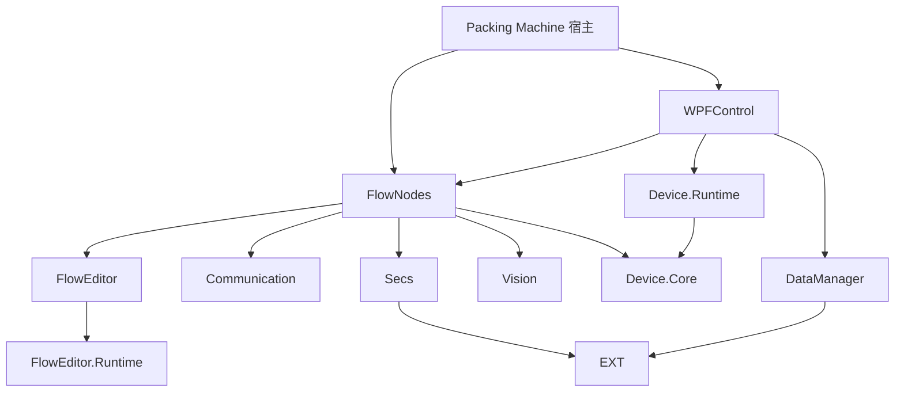

# 项目优化盘点（2026-09-28）

**范围**：仓库的 15 个源码模块、63 个非临时 `.csproj`；`Frame.sln` 收录其中 51 个。检查了项目引用、目标框架、测试项目分布、现有架构文档，以及高风险路径的源码。此次是静态盘点，没有运行设备、视觉 SDK 或完整构建，因此优先级中的“影响”是代码证据推断，不代表已测得的故障频率。

**读法**：优先处理已能从代码确定的错误；结构调整先补行为测试，再按模块推进。每项的详细证据和验收建议放在所属模块的文档里。

## 优先处理

| 优先级 | 位置 | 发现 | 依据与下一步 |
| --- | --- | --- | --- |
| P1 | [Vision](Vision/OPTIMIZATION.md) | InvI 检测模型的创建结果判断反向；删除模型成功后仍抛异常，并留下使用状态映射 | 两份相同源码均有问题。先用可替换的原生 API 接缝验证创建、删除、重复加载，再修复两份或合并实现。 |
| P1 | [WPFControl](WPFControl/OPTIMIZATION.md) | 业务服务广泛通过 `IContainerProvider` 获取依赖，难以单独构造与验证 | 当前 48 个源码文件引用容器；从相机、启动流程等服务逐步改为显式构造依赖。 |
| P1 | [FlowNodes](FlowNodes/OPTIMIZATION.md) | 一个节点库直接引用 10 个项目，且没有本模块测试项目 | 先为节点加载、持久化与无设备执行建立测试，再评估按设备领域分程序集的实际收益。 |
| P1 | [Packing Machine](<Packing Machine/OPTIMIZATION.md>) | 整机宿主直接引用 13 个项目，但没有宿主测试项目 | 优先做启动、节点发现、配置加载和无硬件失败诊断的集成验收。 |
| P2 | [Extension](Extension/OPTIMIZATION.md) | `PriorityQueueProducerConsumer<T>` 实现的通用接口承诺 `StartAsync`，该方法却总是抛 `NotImplementedException` | 现有测试锁定了抛异常行为；先确认调用契约，再选择专用接口或真正实现。 |

## 解决方案覆盖

仓库有 63 个非临时项目，主解决方案含 51 个。未纳入 `Frame.sln` 的 12 个包括 4 个 secs4net 测试/基准项目、3 个 secs4net 样例、`Communication.Benchmarks`、`NugetPackages` 的 Interop 测试，以及 `Device/Device.csproj`、`Vision/Vision.csproj`、`WinFormControl/WinFormControl.csproj`。这**不等于遗漏或错误**：secs4net 的本地副本有独立解决方案，其他工程也可能是独立验证入口。建议在根 README 写清主解决方案与模块解决方案各自的验证范围，并为不在主解决方案中的三个产品库确定维护状态；不要仅为凑齐项目数盲目加入主解决方案。

## 全模块检查结果

| 模块 | 项目数 | 本次结论 |
| --- | ---: | --- |
| Communication | 5 | 核心库为 `net9.0`，Controls/Workbench 位于 Windows 层，已有测试；本次未确认应立即改动的结构问题。 |
| DataManager | 5 | 有核心与 Workbench 测试。分表实体事务明确拒绝跨独立连接事务，属于已声明限制，不列为缺陷。 |
| Device | 8 | Core 为纯 `net9.0`，Runtime、Controls、Workbench 和三组测试分层；保留现有 Device 门面。 |
| Extension | 5 | 已有单程序集内部边界和架构测试；通用生产消费接口有一项契约不匹配，见模块文档。 |
| FlowEditor | 7 | Runtime 为纯 `net9.0`，有 Smoke、插件和宿主测试；现有 `ARCHITECTURE.md` 与迁移计划是优先依据，本次未追加未经验证的大重构。 |
| FlowNodes | 2 | 高依赖半径且缺本模块测试，见模块文档。 |
| MotionControl | 2 | 有独立测试项目，未确认新的高优先级问题。 |
| NugetPackages | 2 | Interop 测试不在主解决方案；保留厂商边界，按模块解决方案验证。 |
| Packing Machine | 1 | 整机宿主缺自动化验收入口，见模块文档。 |
| ScriptEditor | 2 | 有独立测试项目，未确认新的高优先级问题。 |
| Secs | 13 | 本地 secs4net 副本及其多目标框架是既定兼容设计；不要用包替换。独立测试/样例需按该模块解决方案验证。 |
| Vision | 5 | InvI 生命周期存在可直接确定的错误；主解决方案未收录 `Vision/Vision.csproj`，见模块文档。 |
| WinFormControl | 1 | 小型独立库未进入主解决方案；先确认是否仍为交付面，再决定测试和构建归属。 |
| WPFControl | 2 | 现有架构报告中的服务定位器问题仍可在当前源码复核，见模块文档。 |
| WPFCustomControls | 3 | PropertyGrid Core 为纯 `net9.0`，有独立测试和架构文档；视觉修复须在实际宿主重新加载 DLL 后验证。 |

## 依赖概览

图只展示与本次发现有关的显式 `ProjectReference`，不是全部 51 个项目的完整依赖图。宿主和装配入口拥有较多引用本身合理；优化依据是可替换性、验证成本与行为错误，而不是引用数量单项指标。

## 方法与局限

- 按仓库规则先用 `codebase-memory` 查询结构与调用，再核对 `.csproj`、`.sln` 和具体源码；图索引本次对若干引用文件报告 `freshness: missing`，故这些结论均用文件直接读取复核。图中的 32 个调用环是**方法级**强连通分量，不能据此断言项目引用有环。
- 未改变项目配置或源码，未运行构建和测试。没有测试项目只说明缺少独立的自动化入口，不等于该功能从未被手工验证。
- 现有架构约束应优先遵守：纯逻辑 Core 不引入 WPF；Device 门面保留；secs4net 本地副本及兼容目标框架保留；平台仍为 AnyCPU。

## 建议的实施顺序

1. 修复并验证 Vision 的 InvI 创建、删除和重复加载行为。
2. 为整机宿主与 FlowNodes 补覆盖关键集成路径的测试入口。
3. 以一个服务为单位减少 WPFControl 的容器定位，保留对外模块注册 API。
4. 明确 Extension 生产消费接口的能力边界，再调整契约和测试。
5. 在 README 标注各解决方案的验证范围与独立项目的维护状态。
