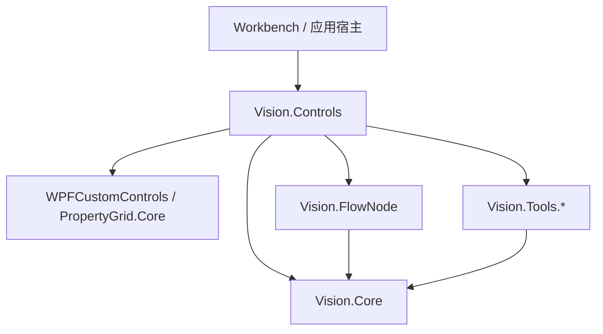

# Vision.Controls

## 新引擎可选装配（P2第四批）

Services/Composition/VisionEngineRegistration提供RegisterVisionEngine：消费冻结的Core选择值，校验已接通模块身份，不读取宿主配置、不注册页面。每个装配owner只创建一个IVisionEngine，延迟工厂在第一次解析时运行；Prism每次解析都经关闭守卫，实例由owner而非多个瞬态执行器持有。已有注册不能覆盖，未知选择不触发SDK。

返回IAsyncDisposable是宿主装配所有权，不是第二个业务Session/Provider；业务仍只注入Core.IVisionEngine。宿主必须在借用页面/节点停止后await DisposeAsync；空关闭不加载SDK，初始化竞争时等待真正工厂返回，释放失败保持句柄可重试。重新选择需要停止释放并重新装配/重启，不支持热切换。

**本轮未让旧VisionToolInstanceWorkspace/节点转发新引擎，也未改变旧UI/工具箱选择。消费者迁移和旧接口退役仍按P3/P4继续。** 主要验证4项配置/装配+1项真实宿主启动正常退出，不重复全量。

工具属性交互第一批已实现：三处奇数参数Step=2，滤波/灰度变换模式行显隐，HSV/RGB动态标签/区间说明及原校验结果的摘要/字段反馈；隐藏字段有错误时会露出供修复。保留原值/JSON/算法和显式执行，不重排流程界面。最终731逻辑/587WPF通过，隔离宿主增量0警告/0错误。其余工具任务式布局仍分批，见[逐项审查与实施进展](docs/TOOL_UI_INTERACTION_AUDIT.md)及[验证记录](../Tests/EDITOR_REFINEMENT.md)。

最新大图预算修复：原图全角计划超预算且模板可安全降采样时，先复用降采样/局部定位，不执行或计费该全图计划；真正执行阶段仍累计受1亿响应像素限制。1920×1080、96×64模板的17.3度靠边/居中案例红绿通过；本轮715逻辑/26定向WPF通过，隔离宿主构建成功。默认目录被运行中的工作台/VS锁文件，须关闭旧进程并重新生成再启动；尚未拿到用户原图复核。详见验证记录。

## 属性栏动作与OpenCV角度匹配修复

- 视觉节点属性栏底部不再放“加载任务图像 / 打开完整工具编辑器 / 设为定位基准”按钮；不修改共享PropertyGrid的其他消费者。双击/节点动作仍打开原唯一编辑器；加载任务图像和选中节点设基准使用顶部“视觉任务”菜单，复用原命令、运行锁和基准捕获。
- 新建Controls目录中的OpenCV/TemplateMatch默认起始-180°、范围360°、粗步长5°；Raw DTO默认值和旧文件仍保持0°/零范围，不自动迁移旧配方。已有节点若要旋转搜索，请显式设置角度范围；范围0仅搜索固定方向。
- 算法先保留原离散匹配；目标不足或存在不安全截断时，新增降采样位置候选、合并局部窗、原图0.5°角度提议和0.1°采样精化。最终仍用原Method/MinScore评分，保留已有有效目标；不是连续优化，不保证0.1°精度。有足额离散解时仍按用户粗步长输出。
- 1024配置姿态、100目标和所有阶段累计1亿响应像素预算仍生效；候选遗漏上界要等最终NMS判断，不可静默剪掉潜在更好结果。大图/全角/宽尺度范围可能明确超预算，需要缩小范围；不承诺实图召回率、节拍或非单位尺度下游跟随。
- 本轮最终713逻辑/580WPF全过，默认宿主64条未改文件警告/0错误。真实实图/人工鼠标及HALCON Runtime未验；详细红绿与命令见[验证记录](../Tests/EDITOR_REFINEMENT.md)。

## 工具内执行与流程执行的图像来源

- 工具编辑器内明确“导入图像”或导入当前工具配置后，工具内执行优先使用本工具本地图；不解析流程图像连接、动态覆盖槽或沿用上一轮流程定位。显式配置的工具本身定位仍保留。
- 流程执行使用显式上游图像连接；未绑定时用任务/会话的流程默认图。工具本地导图不替换此默认图，缺失流程图像或上游失败时不能回退本地图。
- 未导入本地图的工具调试保持原流程绑定准备，以兼容原“先运行上游、再调试下游”方式；本轮不新增来源选择开关或第二套执行器。
- Session保留原ConfiguredImage作为工具配置图，新增默认兼容的FlowInputImage区分流程图；原v1配置只增加UseLocalInputImage可选布尔字段，旧文件缺字段为false。任务图沿原DocumentProperties保存，本地图沿原工具配置保存；改变任务图不会抹掉明确导入的本地图。
- 当前共享同一个工具/DTO/会话/结果拥有者；画面和结果表示最近一次执行，两个执行入口不能并发。保存重开保留图像来源区别，不保存结果/句柄。

最新端口行为：新建视觉工具与Switch不再按添加顺序隐藏Next_IN；开始节点仍无输入。画布首项为视觉工具时仍允许原隐式入口执行，后续未连入工具保持E-IN-REQ；旧.flow显式保存的IsInEnabled=false不自动迁移。新增“先工具后开始”真实连线/执行/重开及兼容测试；本轮706逻辑/575WPF通过，宿主4条未改RoiEditorView警告/0错误。命令与范围见Tests/EDITOR_REFINEMENT.md。

可复用视觉流程页面、工具编辑器及工作区。保留独立Vision.Workbench薄宿主，唯一导航进入本模块VisionFlowView；不并入FlowNodes.Workbench。算法和SDK实现留在Tools。

当前OpenCV模板匹配已支持有界离散旋转/等比Scale，输出实际角度、尺度与旋转矩形；默认旧配置保持原路径。用户掩膜、亚像素/实时性能、非单位尺度下游跟随仍未实施，详见[模型能力](docs/MODEL_CAPABILITIES.md)。本批706逻辑/571WPF通过；WPF首轮诊断超时后单测及同命令全量复跑通过，原因未定。

当前工具注册：基础节点反射元数据与28项视觉延迟工厂合并，原ToolboxService统一搜索/分类，编辑容器与Vision页面共享同一服务；工具箱共35项（28视觉＋7普通控制节点），不再手写Switch或覆盖默认工具集合。CreateToolRegistrations允许其他宿主选择部分或不接入视觉工具；FlowNodes.Workbench本轮未加入Vision，源码不变。容器/并行暂不开放新建，旧文件类型仍可解析。最终验证为679逻辑、568WPF和419 FlowEditor测试全部通过；Vision与FlowNodes宿主构建成功，默认重编仍有未修改文件警告。详细命令/失败修复过程见[验证记录](../Tests/EDITOR_REFINEMENT.md)。

上一轮（2026-10-26）：保留独立Vision.Workbench薄宿主，不合并FlowNodes。VisionBrowserView及代码/旧资源/注册已删除，只用VisionToolEditorView；节点原Session已接通真实打开配置、保存、另存、导图与执行。工具配置保存.visionproj，整个.flow仍由流程工具栏保存；加载保持原节点/会话/DTO/连接，清结果并撤销旧定位基准，不加载模型。Compatibility目录及旧控件名/URI转发已删除，仍被FlowNodes实际调用的ToolEditorView/DetectionToolSession归位正式目录。当前679逻辑/555WPF通过；Vision宿主独立产物目录增量0警告0错误，默认目录生成4条未改RoiEditorView nullable警告/0错误。本轮未重跑FlowNodes消费者构建。MachineApp不涉及；Native及物理未验。详见[当前归位与验证](docs/CODE_ORGANIZATION.md)。

实施计划V1.16（P6复核8/8通过，P7建议待确认）：保留全部HALCON/OpenCV/AI后端，已新增Vision.FlowNode；Workbench任务主路径直接使用通用FlowEditor及本模块的VisionToolInstanceWorkspace/共享编辑器，不新建Vision.FlowEditor。P0复核通过，P1主路径已有离线证据；旧公开任务/节点仍按兼容保留，因此本程序集历史FlowEditor依赖并未全部解除，P1新主路径已复核并采用受控兼容保留策略；P2配置/输入绑定核心闭环已有证据，P2复核已修复真实维护入口/零节点状态并通过完整门禁。P3同图像刚体来源/基准/只读派生搜索域有主链证据，测量工具与局部编辑仍待收口，见FIXTURE_CAPABILITIES.md。P4四视图、训练局部坐标隔离、原输出图契约与呈现适配已通过逻辑386/WPF358及宿主构建；P5离线模型文件/任务重开/候选定位与四类AI身份失效闭环通过390/373及宿主构建；模型引用、只读/模态守卫与设备请求拒绝已补，支持范围见[MODEL_CAPABILITIES](docs/MODEL_CAPABILITIES.md)。P6默认入口已切既有任务组合页并补保存/宿主关闭重开，最终390/381/414通过、宿主0警告/0错误；十项矩阵仍未全部达标，见计划第4节。三个兼容类型受控保留，不能说Controls流程依赖清零。授权SDK及真实鼠标验收另列。

## 依赖与入口



Controls对Tools的引用用于执行/展示适配和既有裁剪调用，不让Core反向依赖WPF或SDK。工程打开、保存和读写协调仍属于Controls，不搬到Workbench。

- **VisionToolNodeBase与八个具体节点**（OpenCv的Blob/FindLine/FindCircle/TemplateMatch/Threshold/GrayStatistics，Common的Geometry/Tolerance）：公共部分与工具专属声明分开；状态/共享绑定和会话执行复用，具体类声明常用原DTO字段和端口。原VisionNodeFactory路由新实例；旧VisionToolNode文档仍按原身份恢复，其余20工具保持通用接入。见[节点结构](../Vision.FlowNode/README.md)。
- **VisionToolInstanceWorkspace**：支持原DTO/ROI/Provider、托管图像/取样及模型引用的严格配置捕获/恢复，打开不加载或训练模型；手动/流程共用输入准备。新主路径的轻量单工具会话，复用原PreparedProjectSelection/Card/DTO/ROI/模型/结果与关闭策略，不含目录切换或流程调度；通过Files partial接通当前工具配置文件命令，复用原Codec/Store。节点接管会话，编辑视图只借用。
- **VisionTaskViewModel（程序化兼容）**：保留原实例/任务生命周期与既有引擎调用；旧列表页面VisionTaskView已删除。需要显示时借原VisionToolEditorView，不重建废弃列表页。
- **VisionTaskToolNode（兼容类型）**：流程调度到原卡片；工作区独占工具和结果，节点只借用。准备/发布回到UI线程，后台执行仍仅由原工具显式能力决定；关闭时等待实际执行归还资源。
- **VisionToolFlowNode（兼容类型） / IImageTool**：原始工具的程序化执行接入，节点拥有工具/结果；支持声明搜索域能力工具的基准ROI平移/旋转跟随，不等于所有工具已支持缩放或镜像。
- **VisionBrowserView已退役**：无容器、注册或资源转发；原Browser VM/Workspace工程能力保留，直接绑定唯一编辑器。
- **VisionToolEditorView**：工程操作、图像操作栏、显示区和详情区的组合；固定工程按钮直接写在XAML。
- **VisionImagePanel**：仅图像显示、状态/绘制提示及右键操作，不再包含顶部操作栏。内部仍复用VisionImageViewport。
- **VisionImageToolbarView**：三个固定图像预设和顶部操作，ImagePanel属性借用同一个显示区；不创建工具或会话。
- **VisionToolEditorSession**：展示状态、参数编辑与图像/ROI命令，借用已有卡片和DTO。
- **VisionBrowserViewModel**：直接继承VisionToolEditorSession，在原单工具会话上提供选择及工程命令；ToolDebug View/Session/Model桥已删除，不复制会话或布局。
- FlowNodes仍调用的ToolEditorView/IEditableTool入口归Views/Editor，DetectionToolSession归ViewModels/Execution，保留其CLR身份与实际实现，不保留Compatibility目录。Ctr_PropertyPanel/Ctr_MultiSelectComboBox空别名、空端口绑定面板及全部旧URI转发已删除；直接使用VisionPropertyPanel/VisionMultiSelectComboBox和正式Views/*、Themes/* URI。旧主题内容仍在Themes/LegacyHalconResources.xaml；旧URI不再承诺兼容，MachineApp不在本轮范围。

## 文件与职责

| 位置 | 只负责 |
| --- | --- |
| Views | 布局、事件到命令的适配；静态界面不写到C# |
| ViewModels | 绑定属性、命令和编辑交互 |
| Models | 页面/工程状态，不执行SDK或文件操作 |
| Services/Browser | 选择工具、输入及工作区所有权 |
| Services/Projects | 工程清单/图像包编解码、准备/提交与安全写入 |
| Services/Execution | 校验、执行、结果拥有及迟到结果隔离 |
| Presentation | 工具/结果/属性元数据到WPF展示的转换 |
| Themes | 可复用外观，不放工具算法或工程逻辑 |
| Views/Editor/ToolEditorView、ViewModels/Execution/DetectionToolSession | FlowNodes现用IEditableTool编辑和检测适配；不复制完整Vision编辑器 |

## XAML维护规则

- 页面只描述本页布局；相同的只读表格与结果文本配置用页内样式复用，不新增控件工厂或样式选择器。
- ToolDetailsView的文本、标量表、Blob、模板匹配和AI框模板对应不同数据语义，应保留；不是固定按钮的动态生成。
- Blob结果直接使用WPFCustomControls.DataGridView，BlobResultsGrid仅管理按特征追加的列，不拥有结果或复制ItemsSource。
- 属性编辑器依赖运行时ToolPropertyAttribute/PropertyInfo，保留必要反射及通用PropertyGrid.Core；不要给每个工具再做一套参数页。
- 不靠固定外框裁切菜单；不要通过选中时改字重造成图像预设宽度跳动。
- 工具栏的分隔线是静态Border；实际调整列宽的位置才使用GridSplitter。

## 四类图像记录

输入/ROI/结果/训练图共用同一画布。训练视图借用原TemplateEditor/ITemplateTool.TemplateImage，显式模板能力工具才显示入口；无取样禁用，清取样显示空态，不伪造输入。它是取样局部像素，不允许输入ROI/结果/执行搜索域叠加或拾取，即使尺寸相同；缩放/平移/导出不改模型和输入。OpenCV灰度模板无需训练且只支持Mono8；AI加载不称训练。

输出图沿用Core的IOutputImageResult；后端结果绘制适配在Presentation/Rendering/VisionResultDrawing，画布只负责像素显示/手势/变换。不承诺第三方异构几何无需适配；新增转换留Presentation，不给画布增加后端分支。原标量表、结果身份/互选与元数据参数链继续沿用。底部单行分别显示本实例操作状态与图像记录/空态，截断信息有完整提示。

## 图像右键操作

显示区右键提供放大、缩小、1:1、适应图像、平移、选择/编辑及另存为。缩放与滚轮共用视口算法；无图像时操作禁用，绘制中保持原来的右键确认行为。另存为支持PNG/TIFF，保存当前底图原始像素尺寸，不是视口截图，也不包含标注；Mono16保存经像素往返验证。取消文件对话框不改输入或结果。

独立显示可直接设置ImagePanel.ImageViewport.Image；编辑器通过原会话绑定输入、ROI与结果。需要顶部操作时再组合VisionImageToolbarView，测试和宿主按ImageToolbar/ ImagePanel各自Namescope访问，不引入跨控件FindName兜底。

## 模型状态与文件

原TemplateEditor/ITemplateTool拥有者不变：成功重新取样、训练、标脏或清除撤销旧文件引用（不删除文件），保存/加载成功记录路径；任务可恢复内嵌取样，但不读取引用文件、不加载原生模型。模板命令与直接Capture遵守工作区忙态/只读，文件选择返回再检查。OpenCV取样可直接匹配，不冒充训练；HALCON模型和AI推理仍需授权验收。

AI模型路径/设备/Provider改变后必须显式重新加载，不沿用旧会话。当前实际设备适配：HALCON仅默认/cpu，Aiditron/Invi仅默认；其它非空请求明确拒绝，不能无声降级。

## 所有权

| 对象 | 拥有者 | 视图卸载 |
| --- | --- | --- |
| 工具与Provider | 创建它们的Workspace/宿主 | 不释放 |
| 本次执行结果与结果表 | ToolCardWorkspace | 只退订/撤下展示 |
| 参数DTO与ROI | 原工作区/流程节点 | 不复制、不释放 |
| 属性行/动态列订阅 | 创建它们的编辑视图或会话 | 对称退订；重载恢复 |
| 工程候选资源 | PreparedProjectSelection | 准备失败释放候选，提交成功才替换旧对象 |

不删除工程事务、执行revision、结果身份或回滚机制来“减少代码”；这些用于防止迟到结果和借用对象误释放。

## 本轮收敛

- 删除无仓库代码/XAML/配置引用的Ctr_PropertyClassList（含旧PropMeta/GroupedProps）和PropertiesConverter。
- ToolDetailsView由578行收敛至458行，复用三份页内样式承载重复表格、关联选择和文本配置，移除空容器；不更改列含义、测量单位、参数或算法。
- 五个操作按钮固定显示；页内样式仅控制缺少工程命令时的禁用，显隐开关已删除，保留直接Button与同一实例；不再依赖名为ProjectActions的包装容器。工程按钮间距统一为向右留白，消除首按钮与图像区的2px偏移。
- 清除已删除文件的Compile/Page/Resource声明和兼容目录；以实际调用保留必要实现，旧控件别名/转发URI明确退役，不凭知识图谱零引用删除。
- 不再在本README累积多轮相互冲突的“最新”记录。历史过程及真实测试结果统一见验证记录。

## 接入与验证

- [视觉软件实施计划：阶段验收 → 联网对照 → 更新计划](docs/IMPLEMENTATION_PLAN.md)

- [单工具编辑器接入](docs/TOOL_EDITOR_INTEGRATION.md)
- [文件布局与历史迁移表](docs/FILE_LAYOUT.md)
- [验证记录与未验收项](../Tests/EDITOR_REFINEMENT.md)

```powershell
powershell.exe -NoProfile -NonInteractive -ExecutionPolicy Bypass -File "Software Frame/Vision/Tests/Verify-EditorRefinement.ps1" -Full -ArtifactsPath "Software Frame/Vision/Tests/obj/editor-verification"
```

按每轮实际执行范围报告，不将历史全绿作为当前结果；最新命令、失败及未验收边界见验证记录。

RequiresRuntime/Skip必须保留。构建和STA测试不代表真实SDK、人工鼠标、主题/DPI或生产整机已验收。
