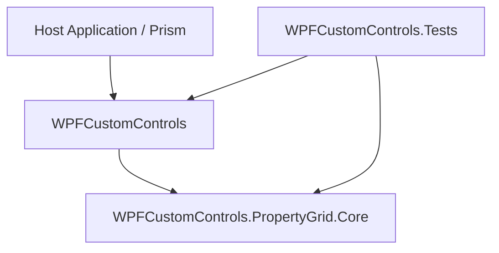

# WPFCustomControls Architecture

## Direction

The project uses a pragmatic layered architecture: dependencies point from WPF-specific
presentation code toward platform-neutral policy and presentation-model code.

`WPFCustomControls.PropertyGrid.Core` never references WPF or the outer
`WPFCustomControls` assembly. The outer assembly owns Views, ResourceDictionaries,
dialogs, Dispatcher adapters, and the Prism composition root.

## Modules

| Module | Responsibility | May depend on |
| --- | --- | --- |
| `WPFCustomControls.PropertyGrid.Core` | Property metadata, view-model state, reflection-based property construction, UI-neutral seams | BCL, CommunityToolkit.Mvvm |
| `WPFCustomControls` | WPF controls, Views, dialogs, resources, WPF adapters, Prism registration | Core, WPF, Prism, MaterialDesign, compatibility Extension |
| `WPFCustomControls.Tests` | Core behavior, WPF smoke tests, architecture rules | Core and WPF assemblies |

## Dependency rules

1. Core code must not reference `System.Windows`, `PresentationFramework`,
   `PresentationCore`, `WindowsBase`, or the outer WPF assembly.
2. A ViewModel crosses into WPF through a small seam such as `IUiDispatcher` or
   `IPortDialogService`; concrete WPF adapters remain in the outer assembly.
3. Prism registrations belong to `Common/Composition`. Feature registrars are stateless;
   `WPFCustomControlsModule` only orchestrates them and initializes resources.
4. XAML that consumes Core types must specify
   `assembly=WPFCustomControls.PropertyGrid.Core` in its CLR namespace mapping.
5. SDK default item globs must exclude sibling projects and migration drafts so a source
   file is compiled by exactly one project.
6. Public PropertyGrid types moved to Core are forwarded by the outer assembly so existing
   compiled consumers retain binary compatibility.

## Internal deep modules

Core keeps its public ViewModel interfaces stable while concentrating volatile implementation
knowledge in internal modules:

| Internal module | Hidden knowledge |
| --- | --- |
| `PropertyValueAccessor` | Reflection access, culture-aware conversion, enum descriptions, nullability, numeric ranges and stepping |
| `PortRowSession` | Cached port reflection metadata, model/ViewModel synchronization and subscription lifetime |
| `PortBindingCoordinator` | Binding lookup precedence and create/replace/remove invariants |

Tests continue to exercise these modules through the public ViewModel interface. This keeps
internal refactoring local and prevents internal seams from leaking into consumers.

## Adding a feature

- Pure PropertyGrid state or rules: add them to Core and test through the public interface.
- WPF rendering, dialogs, converters, or Dispatcher behavior: add them to the outer project.
- Container wiring: update the feature registrar, not the module entry point.
- A new external dependency requires a seam only when production and test adapters are both
  useful; avoid pass-through interfaces that add no leverage.

## Migration note

The nested `WPFCustomControls/` directory is retained as an excluded migration draft to
avoid destroying uncommitted work. It is not part of the canonical build. The canonical
entry remains the root `WPFCustomControls.csproj`; the canonical Core project is the sibling
`WPFCustomControls.PropertyGrid.Core/WPFCustomControls.PropertyGrid.Core.csproj`.
